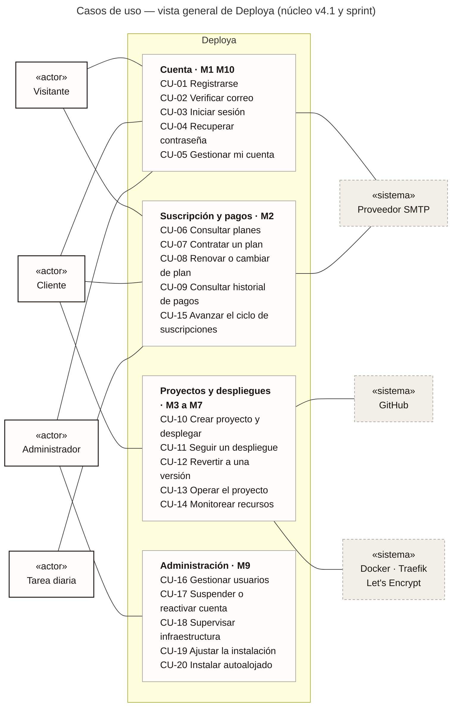
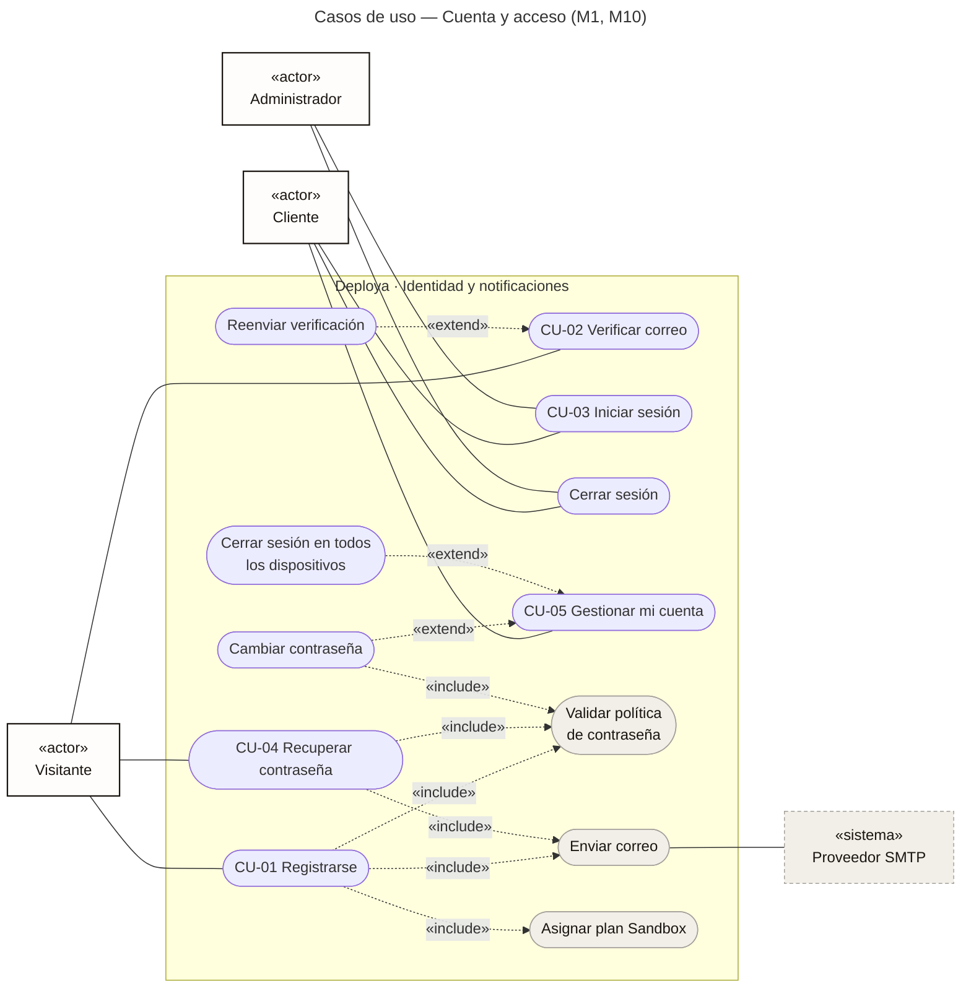
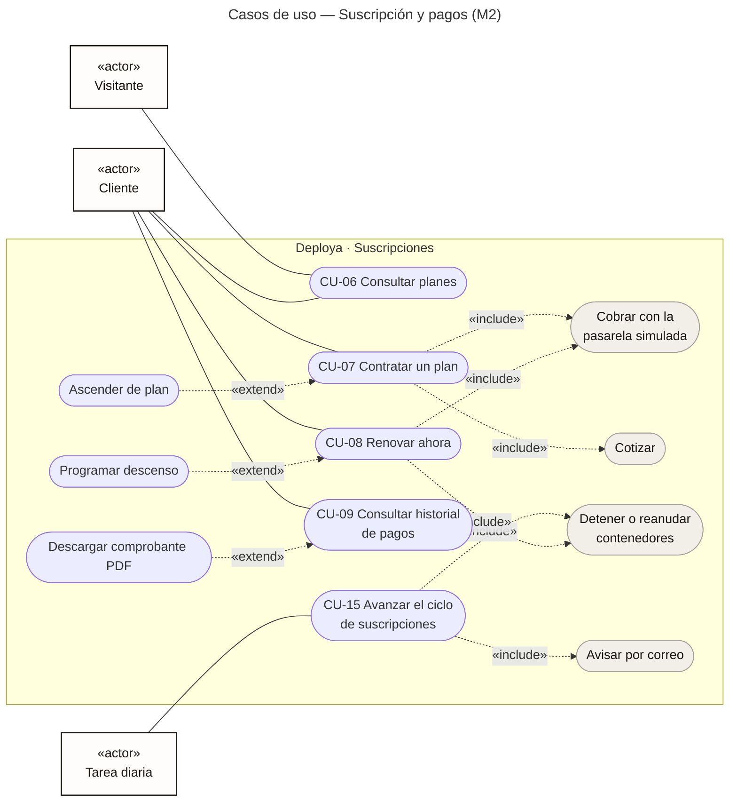
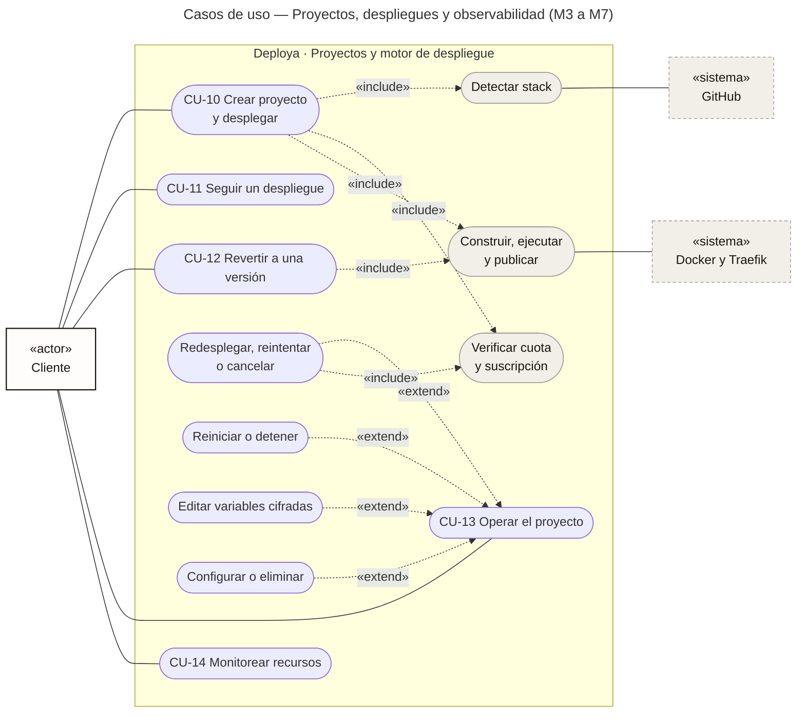
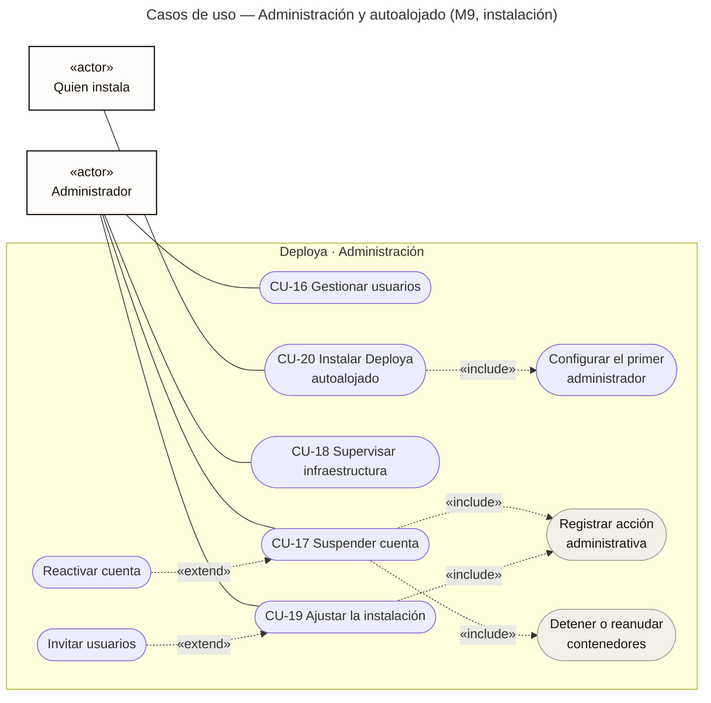
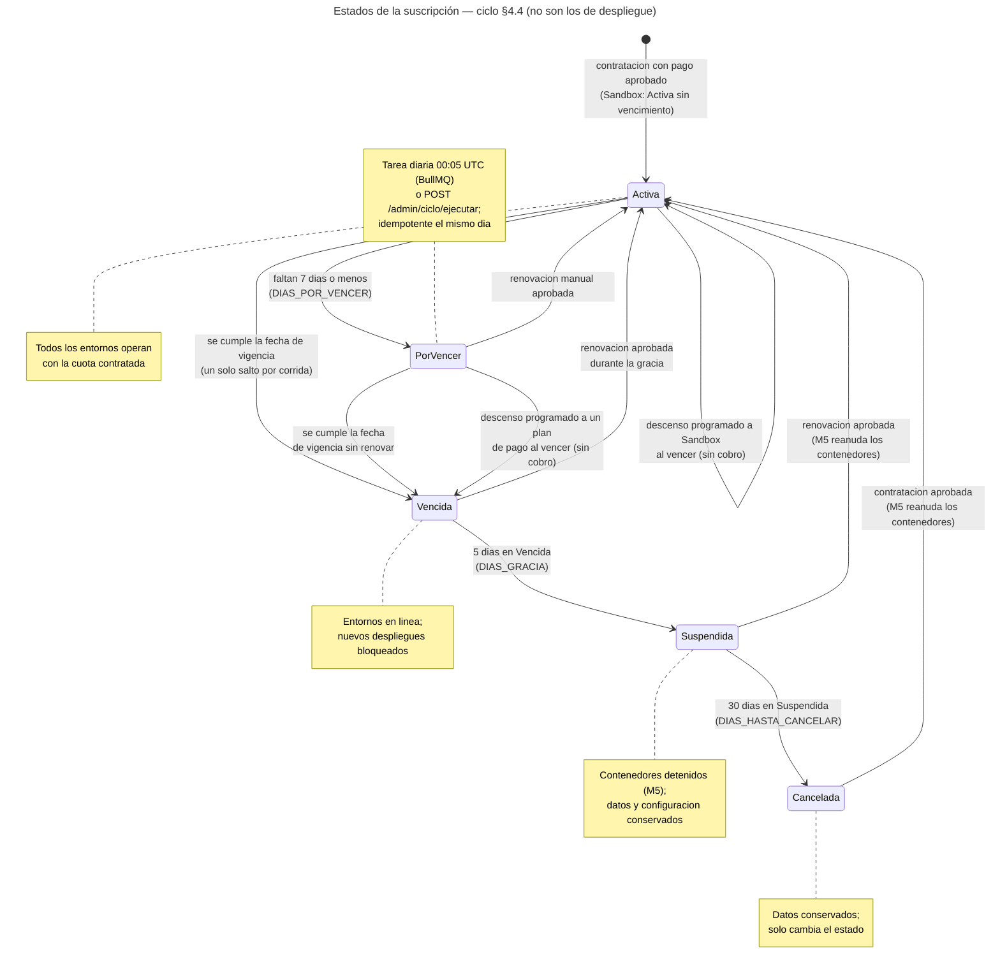
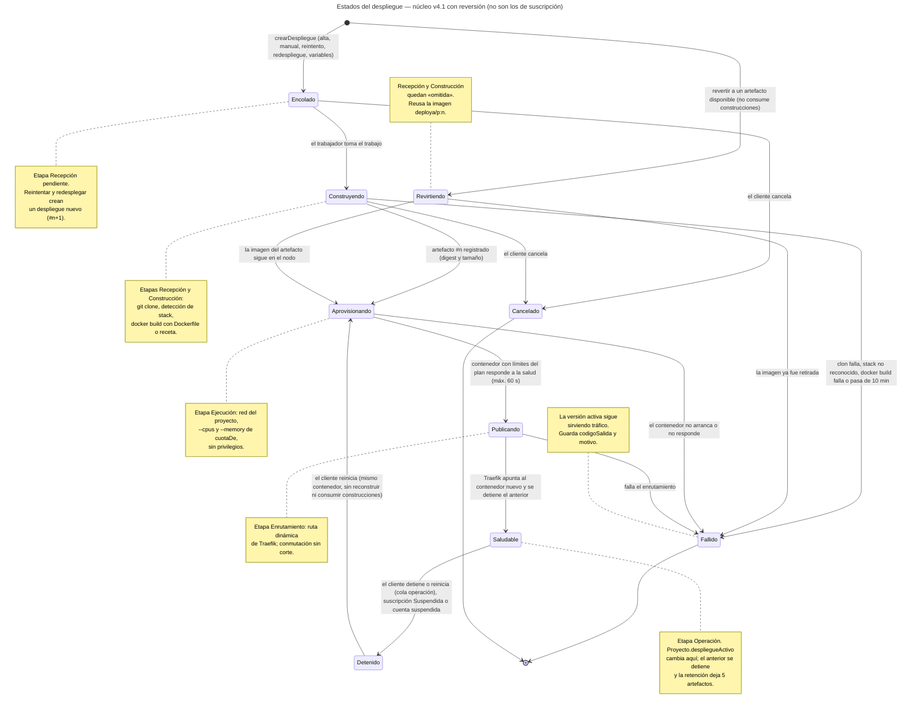

# Documento de requisitos

## Introducción

### Propósito

Este documento define **qué hace Deploya, para quién y cómo se comprueba que lo hace**. Reúne en un solo lugar lo que en el repositorio vive repartido entre la propuesta, el alcance, los specs de OpenSpec y las fichas de pantalla, y lo ordena con el formato que pide el enunciado del curso: introducción, alcance, requisitos funcionales, requisitos no funcionales y casos de uso.

Lo leen tres públicos:

- **El docente**, para verificar que cada característica obligatoria del enunciado tiene un requisito, un caso de uso y una prueba que lo respaldan (capítulo 8, *Trazabilidad*).
- **El equipo**, como contrato de lo entregado: cada requisito apunta al spec y a la pantalla de donde sale.
- **Quien continúe el producto**, para saber qué quedó fuera y por qué.

> [!NOTE]
> Los requisitos de este documento **no se inventan aquí**: cada uno resume un `Requirement` de `openspec/specs/<módulo>/spec.md`, y cada escenario de esos specs tiene al menos una prueba unitaria con su nombre. Si este documento y un spec no coinciden, manda el spec.

### Visión del producto

**Deploya es una plataforma como servicio (PaaS) de alojamiento web.** Un desarrollador pega la URL de un repositorio público de GitHub y, sin escribir configuración de infraestructura, obtiene su aplicación en línea en `https://<proyecto>.deploya.app`, con certificado válido, límites de recursos que se cumplen de verdad y la posibilidad de volver a una versión anterior en segundos.

Dentro del enunciado, Deploya pertenece a la **Opción C: Servidores Web como Servicio**. Cubre las tres capacidades que la opción exige y va más allá en cada una:

| El enunciado pide | Deploya lo resuelve con |
|---|---|
| Crear entornos web | Un proyecto por repositorio: Deploya detecta el stack (Dockerfile, Node, Python, Go o sitio estático), construye una imagen versionada y la ejecuta en un contenedor aislado |
| Gestionar configuraciones | Variables de entorno cifradas (AES-256-GCM), rama, puerto, ruta del `Dockerfile`; redesplegar, reiniciar, detener, revertir y eliminar |
| Monitorear consumo de recursos | CPU y memoria por minuto frente al límite del plan, tiempo por etapa, ritmo de construcciones del mes y bitácoras de construcción y de ejecución |
| Gestión de dominios simulados | Subdominio automático por proyecto (`<proyecto>.deploya.app`) con HTTPS comodín real, no simulado |

**El problema que atiende.** Publicar una aplicación en un servidor propio exige aprovisionarlo, escribir contenedores, configurar un proxy inverso, gestionar certificados y planear actualizaciones sin cortes. Las plataformas comerciales lo simplifican, pero a cambio encierran el código en un formato propietario y cobran por consumo difícil de prever. Deploya conserva la simplicidad, publica los límites de cada plan y, desde el sprint final, **es de código abierto (AGPL-3.0) y se puede instalar en un servidor propio** con un solo comando.

### Definiciones y siglas

| Término | Significado en Deploya |
|---|---|
| **PaaS** | *Platform as a Service*: el cliente trae el código y la plataforma se encarga de construirlo, ejecutarlo y publicarlo |
| **Proyecto** | Una aplicación del cliente: un repositorio, una rama y un subdominio |
| **Despliegue** | Un intento de poner en línea una versión del proyecto. Tiene número consecutivo (`#n`) y pasa por cinco **etapas** |
| **Etapas** | Recepción → Construcción → Ejecución → Enrutamiento → Operación |
| **Artefacto** | La imagen de contenedor inmutable que deja una construcción exitosa (`deploya/<subdominio>:<n>`) |
| **Reversión** | Volver a un artefacto anterior **sin reconstruir**: tarda segundos y no consume construcciones |
| **Receta** | Plantilla de construcción que Deploya usa cuando el repositorio no trae `Dockerfile` |
| **Suscripción** | El plan contratado por una cuenta y su estado (Activa, Por vencer, Vencida, Suspendida, Cancelada) |
| **Cuota** | Límites del plan: proyectos, CPU y memoria por proyecto, construcciones por mes |
| **Sandbox** | Plan gratuito que recibe toda cuenta nueva; no vence |
| **Ciclo §4.4** | Tarea diaria que mueve las suscripciones entre estados según su vigencia |
| **Autoalojado** | Modo de instalación en el que una organización corre Deploya en su servidor, sin cobro |
| **Puerto / adaptador** | Contrato abstracto que necesita un servicio y la clase que lo implementa contra el exterior (arquitectura hexagonal) |
| **OpenSpec** | Flujo de especificación que usa el equipo: cada historia es un *change* con propuesta, diseño, spec delta y tareas |
| **RF / RNF / CU / RN** | Requisito funcional, requisito no funcional, caso de uso, regla de negocio |

### Referencias

| Documento | Dónde |
|---|---|
| Enunciado del proyecto final 2026 | Entregado por el docente |
| Propuesta de proyecto (agosto) | `docs/propuesta.md` |
| Alcance del núcleo v4.1 (fuente de verdad del alcance) | `docs/alcance.md` |
| Specs por módulo (11 specs, 70 requisitos, 295 escenarios) | `openspec/specs/*/spec.md` |
| Fichas de pantalla del design system v4.1 | `docs/diseno/pantallas/` |
| Documento de diseño, manual técnico y manual de usuario | Documentos 2, 3 y 4 de esta entrega |

## Alcance

### En una frase

Un cliente se registra, verifica su correo, contrata un plan con pago simulado, pega la URL de un repositorio público de GitHub y Deploya lo construye, lo corre en un contenedor con los límites de su plan y lo publica con HTTPS. Cada versión queda guardada y se puede volver a una anterior sin reconstruir. Un administrador ve a los usuarios, suspende o reactiva cuentas y supervisa el servidor.

### Recorrido que se evalúa

1. Registro → verificación de correo → inicio de sesión (la cuenta arranca en Sandbox, sin tarjeta).
2. Ver planes → contratar con la pasarela simulada (aprobado o rechazado) → comprobante PDF.
3. Crear proyecto: repositorio, variables, revisar → **Desplegar**.
4. Ver el despliegue avanzar por las cinco etapas con su bitácora → *Saludable* → abrir la URL con HTTPS.
5. Operar: redesplegar, **revertir sin reconstruir**, reiniciar, detener, cambiar variables o rama, eliminar.
6. Ciclo de la suscripción: por vencer (aviso por correo) → vencida (bloquea despliegues) → suspendida (contenedores detenidos) → renovar (se reanudan).
7. Administración: buscar usuarios, suspender y reactivar cuentas, ver la infraestructura.

### Módulos del sistema

El sistema se divide en diez módulos. Nueve están implementados; M8 quedó como *stub* por decisión de alcance.

| Id | Módulo | Responsabilidad | Dueño | Estado |
|---|---|---|---|---|
| M1 | Identidad y acceso | Cuentas, sesiones, roles, recuperación, primera configuración | Eddy | Completo |
| M2 | Suscripciones y pagos | Catálogo, contratación simulada, cuotas, ciclo de vida, comprobantes | Javier | Completo |
| M3 | Proyectos y fuentes | Alta desde GitHub, variables cifradas, configuración | Eduardo | Completo |
| M4 | Motor de construcción | Cola, clonado, detección de stack, `docker build`, bitácora | Derek | Completo |
| M5 | Orquestación y ejecución | Contenedores con límites, salud, versionado, reversión, métricas | Derek | Completo |
| M6 | Enrutamiento y TLS | Subdominio, Traefik, certificado comodín, conmutación sin corte | Derek | Completo |
| M7 | Observabilidad | Vista de despliegue, resumen, historial, consumo, métricas | Eduardo | Completo |
| M8 | Asistente e integración | Fuera de alcance; responde solo `GET /herramientas/health` | Derek | Stub |
| M9 | Administración | Usuarios, suspensión, reactivación, instalación, infraestructura | Javier | Completo |
| M10 | Notificaciones | Correo por puerto intercambiable; verificación, recuperación y avisos | Eddy | Completo |

### Servicios ofertados (planes)

El enunciado (§4.2) pide que cada servicio tenga nombre, descripción, precio y vigencia. Deploya vende **entornos web administrados** en cuatro planes, cargados por *seed* y leídos siempre de la base (nunca de constantes en la web):

| Plan | Descripción | Precio (30 días) | Vigencia | Proyectos | CPU / proyecto | Memoria / proyecto | Construcciones / mes |
|---|---|---|---|---|---|---|---|
| **Sandbox** | Para probar sin tarjeta | Sin costo | Sin vencimiento | 1 | 0.25 vCPU | 256 MB | 30 |
| **Starter** | Proyectos personales | USD 5.00 | 30 o 365 días | 3 | 0.5 vCPU | 512 MB | 150 |
| **Pro** | Equipos pequeños | USD 15.00 | 30 o 365 días | 10 | 1 vCPU | 1 GB | 500 |
| **Business** | Producción ligera | USD 40.00 | 30 o 365 días | 25 | 2 vCPU | 2 GB | 2 000 |

Los límites **se aplican**: CPU y memoria van como parámetros del contenedor (`--cpus`, `--memory`), y proyectos y construcciones se validan antes de crear nada.

### Fuera de alcance

Se diseñó en la propuesta, pero no entra en esta entrega. Cada punto podría volver con su propio change de OpenSpec.

| Qué | Por qué quedó fuera |
|---|---|
| Asistente con modelo de lenguaje y servidor de integración (M8) | Mayor riesgo y sin pantalla en el canvas v4.1 |
| Repositorios privados (OAuth de GitHub) y carga por archivo comprimido | Solo repositorio público; reduce superficie de ataque |
| Dominios personalizados | Sin pantalla; el subdominio automático cubre el caso |
| Renovación automática y prorrateo | La renovación es manual; un ascenso paga el plan completo |
| Complementos y gestión de planes desde administración | Catálogo fijo por *seed* |
| Roles Operador de infraestructura y Soporte técnico | El enunciado los marca como opcionales; la vista de infraestructura la ve el Administrador |
| Transmisión en vivo por WebSocket | El *polling* cada 3 s cumple ([ADR 0006](../adr/0006-polling-en-vez-de-websocket.md)) |
| Varios nodos, escalado horizontal, CDN, cobro con dinero real | Fuera desde la propuesta (§6.2) |

### Supuestos y restricciones

| Tipo | Enunciado |
|---|---|
| Restricción | Un solo nodo: un VPS Ubuntu 24.04 con 2 vCPU y 4 GB, Docker Engine y Compose |
| Restricción | Solo repositorios **públicos** de GitHub, con `Dockerfile` o con un stack reconocido |
| Restricción | Pago **simulado**: no se procesa dinero real; del número de tarjeta solo se guardan los últimos 4 dígitos |
| Restricción | Stack fijado por el equipo: NestJS + Next.js (Node.js 22), PostgreSQL 16, Redis 7, Docker, Traefik v3 |
| Supuesto | El DNS del dominio tiene registros A para `<dominio>` y `*.<dominio>` y un token del proveedor para DNS-01 |
| Supuesto | Hay un proveedor SMTP externo (Resend o Brevo) con SPF y DKIM para que los correos lleguen a la bandeja |
| Supuesto | Las aplicaciones de los clientes escuchan HTTP en un puerto interno (8080 por defecto) |

## Actores y roles

### Actores

| Actor | Tipo | Descripción |
|---|---|---|
| **Visitante** | Humano, sin sesión | Ve los planes, se registra, verifica su correo y recupera su contraseña |
| **Cliente** | Humano, rol `cliente` | Desarrollador que contrata un plan, crea proyectos, despliega y opera sus aplicaciones |
| **Administrador** | Humano, rol `administrador` | Supervisa usuarios, suspende y reactiva cuentas, ajusta la instalación y ve la infraestructura. En la nube se crea por *seed*; en autoalojado, con el código de configuración |
| **Quien instala** | Humano, fuera de la plataforma | Corre `instalar.sh` en un servidor propio y crea el primer administrador (modo autoalojado) |
| **Tarea diaria** | Sistema, programado | Avanza el ciclo de las suscripciones a las 00:00 UTC |
| **Trabajador** | Sistema, proceso aparte | Consume la cola: clona, construye, ejecuta, publica y toma métricas |
| **GitHub** | Sistema externo | Origen del código (API REST pública y `git clone`) |
| **Proveedor SMTP** | Sistema externo | Entrega los correos (Mailpit en desarrollo) |
| **Let's Encrypt y DNS** | Sistemas externos | Certificado comodín por DNS-01 y resolución de `*.deploya.app` |

### Matriz de permisos por rol

Los permisos se aplican en la API con `SesionGuard` y `RolGuard` (un Cliente recibe **403** en cualquier ruta de administración) y en la web con el mismo criterio. Un cliente nunca ve recursos de otro: la API responde **404** a un proyecto, despliegue o pago ajeno, para no revelar que existe.

| Capacidad | Visitante | Cliente | Administrador |
|---|:---:|:---:|:---:|
| Ver planes | ✓ | ✓ | ✓ |
| Registrarse, verificar, recuperar contraseña | ✓ | — | — |
| Gestionar su cuenta y su sesión | — | ✓ | ✓ |
| Contratar, renovar, cambiar de plan, ver pagos | — | ✓ | — |
| Crear y operar **sus** proyectos | — | ✓ | — |
| Ver y buscar todos los usuarios | — | — | ✓ |
| Suspender y reactivar cuentas (no a otro administrador) | — | — | ✓ |
| Ver infraestructura y ajustar la instalación | — | — | ✓ |

## Requisitos funcionales

Cada requisito resume un `Requirement` de OpenSpec. **Prioridad:** *Debe* es imprescindible para el núcleo; *Debería* es núcleo pero se dejó al final; *Sprint* entró en el sprint fuera de alcance aprobado el 20 de octubre. La columna *Escenarios* cuenta los criterios de aceptación del spec; cada uno tiene su prueba.

### M1 · Identidad y acceso

| Id | Requisito | Prioridad | Pantallas | Escenarios |
|---|---|---|---|---|
| RF-01 | El sistema crea una cuenta con correo único y contraseña de al menos 12 caracteres con mayúscula, minúscula, número y símbolo. La cuenta queda *pendiente de verificación* y con plan Sandbox | Debe | 01, 01b | 4 |
| RF-02 | La cuenta se activa solo con un enlace de verificación vigente (24 h) y de un solo uso. Se puede pedir un reenvío tras una cuenta atrás de 60 s; el reenvío invalida el enlace anterior y responde igual exista o no la cuenta | Debe | 02 | 5 |
| RF-03 | El sistema inicia sesión solo a cuentas Activas, distingue credenciales incorrectas, cuenta sin verificar y cuenta suspendida (con su motivo), y cierra la sesión tras 7 días sin actividad | Debe | 03, 03b, 28 | 7 |
| RF-04 | El sistema distingue los roles Cliente y Administrador; las rutas de administración responden 403 a un Cliente | Debe | 28 | 2 |
| RF-05 | El cliente restablece su contraseña con un enlace de un solo uso que caduca en 30 minutos; la respuesta es neutra, pedir otro invalida el anterior y restablecer cierra todas las sesiones | Debería | 04 | 7 |
| RF-06 | El cliente edita su nombre (máx. 64), ve correo y rol, cambia su contraseña con la actual (cierra las demás sesiones) y cierra sesión en todos los dispositivos | Debería | 05, 05b | 7 |
| RF-07 | Mi cuenta · Seguridad muestra la fecha del último cambio de contraseña | Sprint | 05b | 3 |
| RF-08 | Las pantallas de acceso muestran una ilustración animada que respeta `prefers-reduced-motion` y es decorativa para lectores de pantalla | Sprint | 01, 03 | 3 |
| RF-09 | En autoalojado y sin administrador, `/configurar` pide el código de un solo uso del instalador, crea **un solo** administrador aunque lleguen dos altas a la vez, prueba el SMTP o sigue sin correo | Sprint | 31 | 10 |

### M10 · Notificaciones

| Id | Requisito | Prioridad | Pantallas | Escenarios |
|---|---|---|---|---|
| RF-10 | Todo correo sale por `CorreoPuerto`; el proveedor (SMTP real, Mailpit o consola) se elige por variables de entorno sin tocar código, y un fallo del proveedor se registra sin romper el flujo | Debe | — | 5 |
| RF-11 | Existen plantillas en español de verificación (24 h) y recuperación (30 min, un uso, «si no la pediste, ignórala»), con botón y enlace en texto plano | Debe | 24 | 3 |
| RF-12 | El titular recibe un correo cuando un despliegue termina Saludable o Fallido y cuando su suscripción pasa a Por vencer o Suspendida | Sprint | 24b | 4 |
| RF-13 | En autoalojado el correo usa el SMTP guardado por el asistente o Admin · Instalación, sin reiniciar | Sprint | 31, 32 | 3 |

### M2 · Suscripciones y pagos

| Id | Requisito | Prioridad | Pantallas | Escenarios |
|---|---|---|---|---|
| RF-14 | El catálogo de planes activos se expone sin sesión, ordenado, con precio a 30 y 365 días y sus cuatro límites | Debe | 06 | 3 |
| RF-15 | Toda cuenta nueva recibe una suscripción Sandbox Activa, sin costo ni vencimiento | Debe | — | 4 |
| RF-16 | El cliente contrata un plan con la pasarela simulada: `4242…` aprueba, `…0002` rechaza, `…3220` tarda 5 s y cualquier otra se rechaza. Un pago aprobado lleva comprobante consecutivo `DPY-AAAA-NNNNNN` | Debe | 07, 07b | 5 |
| RF-17 | El cliente renueva manualmente (suma la vigencia al final de la actual), asciende de plan (paga completo, vigencia nueva) o programa un descenso sin cobro que aplica al vencer | Debería | 08 | 4 |
| RF-18 | El cliente ve su historial de pagos con fecha, concepto, monto y estado, y descarga el comprobante PDF de los aprobados («simulado, sin valor fiscal») | Debería | 09, 09b | 4 |
| RF-19 | El sistema impide crear proyectos y construcciones por encima del límite del plan; el período de construcciones es el mes calendario UTC | Debe | 08, 10 | 2 |
| RF-20 | Una tarea diaria mueve las suscripciones: Activa → Por vencer (≤ 7 días) → Vencida (gracia de 5 días, bloquea altas y despliegues) → Suspendida (detiene contenedores) → Cancelada (30 días suspendida). Es idempotente y Sandbox no vence | Debe | 10c, 28 | 8 |
| RF-21 | Mi suscripción muestra plan, estado, vigencia, días restantes, precio de renovar, consumo y descenso programado | Debería | 08 | 3 |
| RF-22 | El *seed* crea de forma idempotente los planes, el administrador y las cuentas de demostración (`cliente@`, `vencida@`, `suspendida@`) | Debe | — | 5 |
| RF-23 | Con `MODO_INSTALACION=autoalojado` hay un único plan sin cobro ni vencimiento, los límites los fija el administrador y el ciclo no corre | Sprint | 30, 32 | 10 |
| RF-24 | El ciclo avisa por correo una sola vez al pasar a Por vencer y a Suspendida | Sprint | 24b | 2 |

### M3 · Proyectos y fuentes

| Id | Requisito | Prioridad | Pantallas | Escenarios |
|---|---|---|---|---|
| RF-25 | El cliente ve solo sus proyectos, con búsqueda, estado del último despliegue y contador frente al límite; sin proyectos ve la guía del primero. La lista se actualiza cada 3 s mientras algo está en curso | Debe | 10, 10b | 4 |
| RF-26 | El cliente crea un proyecto desde la URL de un repositorio público de GitHub, una rama y un nombre (que define el subdominio). El sistema verifica el repositorio, detecta cómo construirlo y propone el puerto desde `EXPOSE` | Debe | 11a, 11e | 11 |
| RF-27 | El alta se bloquea si se alcanzó el límite de proyectos, si la suscripción está Vencida o Suspendida o si se agotaron las construcciones; todas las verificaciones ocurren antes de guardar | Debe | 10, 10c, 28 | 8 |
| RF-28 | Al confirmar, el sistema guarda el proyecto y lanza el despliegue #1 | Debe | 11d | 2 |
| RF-29 | Las variables de entorno se guardan cifradas (AES-256-GCM), se muestran enmascaradas y aplican en el próximo despliegue; se puede «guardar» o «guardar y desplegar» | Debe | 11c, 17 | 4 |
| RF-30 | El cliente cambia nombre, repositorio, rama, ruta del `Dockerfile` y puerto (el subdominio no cambia) y elimina el proyecto escribiendo su nombre; eliminar borra contenedor, imágenes y ruta | Debería | 19, 19b | 7 |

### M4 · Motor de construcción

| Id | Requisito | Prioridad | Pantallas | Escenarios |
|---|---|---|---|---|
| RF-31 | Cada despliegue recibe el número siguiente del proyecto, nace Encolado con sus cinco etapas en Pendiente y se encola para el trabajador, fuera del ciclo HTTP | Debe | 12 | 3 |
| RF-32 | El trabajador clona la rama, registra el commit y construye con el `Dockerfile` del repositorio o con una receta, con un tiempo máximo de 10 minutos; cada construcción exitosa registra un artefacto con digest, tamaño, commit y receta | Debe | 12, 12c | 5 |
| RF-33 | Si no hay `Dockerfile`, se reconoce Node, Python, Go o sitio estático (en ese orden); si hay, manda siempre el del repositorio | Debe | 11a, 11e | 7 |
| RF-34 | Cada línea de la bitácora se guarda numerada con marca de tiempo, etapa y nivel, y se consulta desde una posición (máx. 500 líneas) | Debe | 12 | 2 |
| RF-35 | El cliente cancela un despliegue en curso, reintenta uno fallido y redespliega un commit anterior (reconstruye y consume construcción) | Debería | 12, 14 | 7 |
| RF-36 | Las transiciones de estado pasan por una única máquina de estados pura; una transición inválida no persiste nada | Debe | — | 2 |
| RF-37 | Cada despliegue se consulta por su número dentro del proyecto, con las cinco etapas, su duración, commit, imagen, URL y código de salida | Debe | 12 | 3 |
| RF-38 | El motor expone la duración de cada etapa de los últimos despliegues, con 0 en las omitidas y la etapa donde falló un Fallido | Sprint | 14c | 2 |

### M5 · Orquestación y ejecución

| Id | Requisito | Prioridad | Pantallas | Escenarios |
|---|---|---|---|---|
| RF-39 | Cada contenedor corre con la CPU y la memoria del plan, sin privilegios (`CapDrop: ALL`, `no-new-privileges`) y en una red propia del proyecto | Debe | 13 | 2 |
| RF-40 | Antes de publicar, el sistema verifica que el contenedor responde HTTP (< 500) en su puerto, cada segundo y hasta 60 s | Debe | 12 | 2 |
| RF-41 | El cliente reinicia y detiene el contenedor activo sin reconstruir; al eliminar el proyecto se borran contenedor, imágenes y ruta | Debería | 13, 19b | 6 |
| RF-42 | Si la suscripción o la cuenta se suspenden, los contenedores del cliente se detienen; al reactivar, vuelven a arrancar | Debe | 10c, 25b | 3 |
| RF-43 | Se conservan los 5 artefactos más recientes por proyecto más el activo; el resto se retira | Debe | 14 | 2 |
| RF-44 | El cliente vuelve a un artefacto disponible **sin reconstruir**: el despliegue nace *Revirtiendo*, omite Recepción y Construcción, no consume construcciones y, si la salud falla, la versión activa no cambia | Debe | 14 | 6 |
| RF-45 | Un despliegue que construye se rechaza si la suscripción está Vencida o Suspendida o si se agotaron las construcciones del mes; la reversión no cuenta | Debe | 10c, 14 | 6 |
| RF-46 | El contenedor recibe las variables descifradas y `PORT`; la bitácora registra cuántas, nunca sus valores | Debe | 12 | 3 |
| RF-47 | El trabajador toma una muestra de CPU y memoria por minuto de cada contenedor Saludable y conserva 24 h | Sprint | 16, 13c | 6 |

### M6 · Enrutamiento y TLS

| Id | Requisito | Prioridad | Pantallas | Escenarios |
|---|---|---|---|---|
| RF-48 | Cada proyecto se publica en `<subdominio>.<dominio>` solo después de pasar la salud; renombrar no cambia el subdominio | Debe | 12b, 13 | 2 |
| RF-49 | En el servidor el tráfico va por HTTPS con un certificado comodín emitido por DNS-01; HTTP redirige a HTTPS y el panel muestra hasta cuándo vale el certificado | Debe | 12b | 3 |
| RF-50 | Un despliegue nuevo recibe el tráfico antes de retirar el anterior; si no pasa la salud, la ruta sigue en el anterior | Debe | 12, 12c | 2 |

### M7 · Observabilidad

| Id | Requisito | Prioridad | Pantallas | Escenarios |
|---|---|---|---|---|
| RF-51 | La vista de despliegue muestra el riel de cinco etapas con estado y duración y la bitácora numerada, actualizada cada 3 s y copiable; el sondeo se detiene al terminar | Debe | 12, 12b, 12c | 5 |
| RF-52 | El resumen del proyecto muestra estado, URL, versión activa (número, commit, digest, tamaño), recursos aplicados y la línea de tiempo del último despliegue | Debe | 13 | 3 |
| RF-53 | El historial lista los despliegues de 20 en 20 con filtros (todos, saludables, fallidos), la versión activa resaltada y la acción de cada fila | Debe | 14 | 4 |
| RF-54 | Se expone el consumo del mes (proyectos y construcciones) y la actividad de las últimas 12 semanas | Debería | 08, 13 | 3 |
| RF-55 | El cliente ve CPU y memoria de la última hora o de 24 h frente al límite, con zona de aviso desde 80 %, despliegues marcados y alternativa en tabla | Sprint | 16, 13c | 6 |
| RF-56 | El cliente ve la duración por etapa de los últimos 14 despliegues y la mediana de los saludables | Sprint | 14c | 3 |
| RF-57 | Mi suscripción muestra las construcciones acumuladas del mes contra la cuota y una proyección al cierre | Sprint | 08c | 3 |
| RF-58 | El cliente ve las últimas 500 líneas de la salida de su contenedor, con filtro por nivel, búsqueda, pausa y descarga; Deploya no las guarda | Sprint | 15 | 3 |

### M9 · Administración

| Id | Requisito | Prioridad | Pantallas | Escenarios |
|---|---|---|---|---|
| RF-59 | El administrador lista usuarios con búsqueda por correo y filtro por estado de suscripción, y ve el detalle: rol, suscripción, proyectos y pagos | Debe | 25 | 4 |
| RF-60 | El administrador suspende una cuenta con motivo y detalle; queda registrada la acción y no se puede suspender a otro administrador | Debe | 25b | 4 |
| RF-61 | El administrador reactiva una cuenta suspendida; los contenedores vuelven solo si la suscripción está vigente | Sprint | 25c | 4 |
| RF-62 | En autoalojado el administrador cambia la política de registro (abierto, invitación, cerrado), crea y revoca invitaciones y fija los límites por proyecto | Sprint | 32 | 8 |
| RF-63 | El administrador ve, de solo lectura, CPU, memoria y disco del servidor, el estado de la cola y la última muestra de cada entorno | Sprint | 27 | 3 |

### Instalación y código abierto

| Id | Requisito | Prioridad | Pantallas | Escenarios |
|---|---|---|---|---|
| RF-64 | El repositorio incluye licencia, README, guía de contribución y política de seguridad, y su historial se revisa con `gitleaks` | Sprint | — | 2 |
| RF-65 | `instalar.sh` comprueba requisitos, DNS y certificado antes de escribir nada, se detiene con instrucciones, se retoma con `--continuar` e imprime un código de configuración de un solo uso | Sprint | 30 | 11 |
| RF-66 | `actualizar.sh` respalda, migra y reinicia sin detener las aplicaciones de los clientes (`--volver` restaura); `respaldar.sh` conserva 7 respaldos sin la clave de cifrado | Sprint | 30 | 5 |

## Requisitos no funcionales

Se agrupan según las características de calidad de **ISO/IEC 25010**. Cada uno tiene una métrica que se puede comprobar y dice **cómo se verifica**.

### Seguridad

| Id | Requisito | Métrica / regla | Verificación |
|---|---|---|---|
| RNF-01 | Contraseñas nunca en claro | Hash `scrypt` con sal aleatoria por usuario y comparación en tiempo constante | Prueba unitaria de `HashContrasenaScrypt`; columna `hashContrasena` |
| RNF-02 | Tokens de un solo uso que no se pueden reconstruir desde la base | Se guarda solo el SHA-256 del token de verificación, recuperación, sesión e invitación | Specs `identidad` y `administracion` |
| RNF-03 | Sesión resistente a robo por script | Cookie `HttpOnly`, `SameSite=Lax`, `Secure` en HTTPS; 7 días sin actividad | `cookie-sesion.ts` y sus pruebas |
| RNF-04 | Respuestas que no revelan cuentas | Registro, reenvío y recuperación responden igual exista o no el correo; recursos ajenos → 404 | Escenarios «respuesta neutra» y «proyecto ajeno» |
| RNF-05 | Secretos del cliente cifrados en reposo | Variables con AES-256-GCM, IV distinto por valor; nunca en la bitácora | `CifradorAesGcm` y escenario «La bitácora no muestra valores» |
| RNF-06 | Aislamiento entre clientes | Contenedor sin privilegios, `CapDrop: ALL`, `no-new-privileges`, red propia por proyecto; solo el trabajador monta `docker.sock` | Spec `orquestacion`; [ADR 0002](../adr/0002-cola-bullmq-y-trabajador-aparte.md) y [ADR 0005](../adr/0005-traefik-proveedor-de-archivo.md) |
| RNF-07 | Tráfico cifrado | HTTPS en todo el VPS con certificado comodín; HTTP → 301 | `infra-vps.md` §3 |
| RNF-08 | Control de acceso por rol | `RolGuard`: Cliente → 403 en administración; un administrador no suspende a otro | Escenarios de `identidad` y `administracion` |
| RNF-09 | Repositorio público sin secretos | `gitleaks` sobre todo el historial en cada PR | Job «Secretos (gitleaks)» de CI |
| RNF-10 | Límite de intentos contra fuerza bruta | 5 intentos de código de configuración por IP cada 15 min; el sexto fallo de inicio de sesión responde 429 con `Retry-After` | `LimiteIntentos` (hecho); EST-01a para el inicio de sesión (en curso al cerrar este documento) |

### Rendimiento y eficiencia

| Id | Requisito | Métrica |
|---|---|---|
| RNF-11 | La API nunca construye dentro de una petición | Crear un despliegue responde al encolar; el trabajo pesado ocurre en el trabajador (BullMQ) |
| RNF-12 | Tiempos acotados | Construcción ≤ 10 min; verificación de salud ≤ 60 s; consulta a GitHub ≤ 10 s |
| RNF-13 | Reversión en segundos | Revertir no reconstruye: omite Recepción y Construcción y reutiliza la imagen local |
| RNF-14 | Bitácora eficiente | Se escribe en lotes (cada 500 ms o 50 líneas) y se lee incrementalmente con `desde=` (máx. 500 líneas por respuesta) |
| RNF-15 | Panel sin sobrecarga | *Polling* cada 3 s solo mientras algo está en curso; se detiene al terminar |
| RNF-16 | Métricas con almacenamiento acotado | Una muestra por minuto por contenedor, purga a las 24 h, promedio por cubos de 30 min |

### Fiabilidad y disponibilidad

| Id | Requisito | Métrica |
|---|---|---|
| RNF-17 | Publicar sin corte | El contenedor nuevo recibe tráfico antes de retirar el anterior; si falla la salud, sigue el anterior |
| RNF-18 | Un fallo no tumba lo que funciona | Un despliegue fallido o una variable ilegible nunca cambian la versión activa |
| RNF-19 | Operaciones idempotentes | *Seed*, ciclo diario (una corrida mueve un estado como máximo), encolado (`jobId = despliegueId`) y borrado de proyecto |
| RNF-20 | Recuperación ante desastres | Respaldo diario de base y configuración, 7 retenidos, restauración probada; `actualizar.sh --volver` |
| RNF-21 | Errores externos aislados | Un fallo del SMTP se registra y no se propaga; GitHub caído → «GitHub no disponible», no «repositorio inválido» |

### Usabilidad y accesibilidad

| Id | Requisito | Métrica |
|---|---|---|
| RNF-22 | Coherencia visual | Toda pantalla usa solo los tokens y componentes del design system v4.1 (sin hex sueltos), en modo claro y oscuro |
| RNF-23 | Estados que no dependen del color | Cada estado lleva palabra e icono, no solo color (WCAG 1.4.1) |
| RNF-24 | Movimiento respetuoso | Animaciones solo de `transform` y `opacity`; con `prefers-reduced-motion` quedan quietas |
| RNF-25 | Accesibilidad de formularios y gráficas | Campos con `aria-invalid` y `aria-describedby`; gráficas con alternativa en tabla y navegación por teclado |
| RNF-26 | Lenguaje claro | Interfaz y correos en español; errores que dicen qué pasó y qué hacer (p. ej. «falta `Dockerfile`» con ejemplo) |

### Mantenibilidad

| Id | Requisito | Métrica |
|---|---|---|
| RNF-27 | Arquitectura en capas con puertos | El dominio no importa Nest, Prisma, Docker ni HTTP; ~70 puertos como `abstract class` |
| RNF-28 | Pruebas por escenario | Cada `Scenario` del spec tiene su prueba; 1 069 pruebas de API y 272 de web en verde |
| RNF-29 | Cobertura | ≥ 80 % de líneas en dominio y servicios tocados; hoy **96.8 %** de líneas en toda la API |
| RNF-30 | Integración continua | Cada PR corre pruebas, build, validación de diagramas, `gitleaks`, `shellcheck` y un *smoke* de compose |
| RNF-31 | Decisiones registradas | Cada decisión grande tiene su ADR (formato Nygard) |

### Portabilidad

| Id | Requisito | Métrica |
|---|---|---|
| RNF-32 | Un comando para levantar todo | `docker compose up` arranca Postgres, Redis, API, trabajador, web, Traefik y Mailpit |
| RNF-33 | Configuración por entorno | Dominio, esquema, correo, motor y modo de instalación son variables; el mismo código corre en local, en el VPS y en autoalojado |
| RNF-34 | Sin dependencia del proveedor | Las aplicaciones son contenedores estándar; el cliente se lleva su imagen y su `Dockerfile` |

## Casos de uso

### Vista general

El diagrama muestra los actores, los cuatro paquetes funcionales y los sistemas externos. Los casos de uso se numeran de CU-01 a CU-20; los detallados por subsistema están en las secciones siguientes.

<!-- diagrama: docs/diagramas/casos-de-uso/cu-00-general.mmd -->

### Cuenta y acceso

<!-- diagrama: docs/diagramas/casos-de-uso/cu-01-cuenta.mmd -->

### Suscripción y pagos

<!-- diagrama: docs/diagramas/casos-de-uso/cu-02-suscripcion.mmd -->

### Proyectos y despliegues

<!-- diagrama: docs/diagramas/casos-de-uso/cu-03-proyectos.mmd -->

### Administración y autoalojado

<!-- diagrama: docs/diagramas/casos-de-uso/cu-04-administracion.mmd -->

### Especificación de los casos de uso principales

Cada ficha sigue el formato de Cockburn simplificado: actor, precondiciones, flujo principal, flujos alternos y postcondición. Los números de pantalla son los del canvas v4.1.

#### CU-01 · Registrarse

| | |
|---|---|
| **Actor** | Visitante |
| **Requisitos** | RF-01, RF-02, RF-10, RF-11, RF-15 |
| **Pantallas** | 01 Registro, 01b Estados, 02 Verifica tu correo, 24 Correo de verificación |
| **Precondición** | El visitante no tiene sesión. En autoalojado, la política de registro lo permite |
| **Flujo principal** | 1. El visitante abre `/registro` e ingresa nombre, correo y contraseña. 2. La web valida la política de contraseña mientras escribe. 3. La API crea la cuenta *pendiente*, le asigna Sandbox y guarda el hash de un token de verificación de 24 h. 4. M10 envía el correo con botón y enlace en texto plano. 5. El visitante abre el enlace; la cuenta pasa a *Activa* y el token queda usado |
| **Alternos** | 2a. Contraseña débil → la web señala qué regla falta. 3a. Correo ya registrado → 01b «correo ya registrado» con enlace a iniciar sesión. 4a. El SMTP falla → la cuenta se crea y la pantalla ofrece reenviar. 5a. Token vencido o usado → 02 ofrece reenviar (con cuenta atrás de 60 s) |
| **Postcondición** | Cuenta Activa con suscripción Sandbox; puede iniciar sesión |

#### CU-03 · Iniciar sesión

| | |
|---|---|
| **Actor** | Cliente o Administrador |
| **Requisitos** | RF-03, RF-04 |
| **Pantallas** | 03 Iniciar sesión, 03b Estados, 28 Estados del sistema |
| **Precondición** | La cuenta existe |
| **Flujo principal** | 1. El usuario ingresa correo y contraseña. 2. La API valida contra el hash `scrypt`. 3. Crea una `Sesion` (guarda la huella del token) y responde con la cookie `HttpOnly`. 4. La web lleva a Proyectos (Cliente) o a Usuarios (Administrador) |
| **Alternos** | 2a. Credenciales incorrectas → mensaje genérico. 2b. Cuenta sin verificar → 03b con «reenviar verificación». 2c. Cuenta suspendida → 03b con el motivo y la fecha. 4a. Sesión con 7 días sin actividad → 28 «sesión expirada» |
| **Postcondición** | Sesión vigente; cada petición renueva la actividad |

#### CU-04 · Recuperar contraseña

| | |
|---|---|
| **Actor** | Visitante |
| **Requisitos** | RF-05, RF-11 |
| **Pantallas** | 04 Recuperar contraseña, 24 Correo de recuperación |
| **Flujo principal** | 1. El visitante pide el enlace con su correo. 2. La API responde siempre «si la cuenta existe, te enviamos un enlace». 3. Si la cuenta está Activa, crea un token de 30 min (invalida el anterior) y envía el correo. 4. El visitante abre el enlace y escribe una contraseña que cumple la política. 5. La API cambia el hash, marca el token usado y **revoca todas las sesiones** |
| **Alternos** | 3a. Correo no registrado → misma respuesta, sin correo. 4a. Token vencido, usado o reemplazado → 04 «enlace no válido» con opción de pedir otro. 4b. Contraseña débil → no consume el token |
| **Postcondición** | Contraseña nueva; las sesiones previas quedan cerradas |

#### CU-07 · Contratar un plan

| | |
|---|---|
| **Actor** | Cliente |
| **Requisitos** | RF-14, RF-16, RF-18 |
| **Pantallas** | 06 Planes, 07 Contratar, 07b Resultados, 09 Historial de pagos |
| **Precondición** | Sesión iniciada |
| **Flujo principal** | 1. El cliente compara planes y elige uno con vigencia de 30 o 365 días. 2. La web pide la cotización a la API (`GET /suscripciones/cotizacion`). 3. El cliente ingresa una tarjeta de prueba. 4. `PasarelaPago` simulada aprueba. 5. La API registra el pago con comprobante `DPY-AAAA-NNNNNN`, deja la suscripción Activa con el plan nuevo y cancela un descenso pendiente. 6. 07b muestra «Aprobado» y el enlace al comprobante PDF |
| **Alternos** | 4a. Tarjeta `…0002` → «Fondos insuficientes (simulado)», pago rechazado sin comprobante. 4b. Tarjeta `…3220` → 07b muestra «Procesando» 5 s. 4c. Tarjeta que no es de prueba → rechazada. 1a. Plan de menor nivel con vigencia en curso → `es-descenso`: se ofrece programar el descenso |
| **Postcondición** | Suscripción Activa con las cuotas del plan; pago en el historial |

#### CU-10 · Crear proyecto y desplegar

| | |
|---|---|
| **Actor** | Cliente |
| **Requisitos** | RF-25 a RF-29, RF-31 a RF-33, RF-39, RF-40, RF-48 a RF-50 |
| **Pantallas** | 10 Proyectos, 11a Repositorio, 11c Variables, 11d Revisar, 11e Errores, 12 Despliegue en curso, 12b Saludable |
| **Precondición** | Sesión iniciada; suscripción Activa o Por vencer; cupo de proyectos y de construcciones |
| **Flujo principal** | 1. El cliente pega la URL del repositorio y elige la rama. 2. La API comprueba el límite del plan **antes** de llamar a GitHub. 3. Valida el repositorio, lee el último commit y detecta el `Dockerfile` o el stack. 4. Propone puerto y subdominio. 5. El cliente agrega variables (opcional) y revisa. 6. Al pulsar **Desplegar**, la API guarda el proyecto y encola el despliegue #1. 7. El trabajador clona, construye, ejecuta con los límites del plan, verifica la salud y escribe la ruta en Traefik. 8. El despliegue queda *Saludable* y la app responde en `https://<subdominio>.deploya.app` |
| **Alternos** | 2a. Límite alcanzado o suscripción Vencida → 10c, sin llamar a GitHub. 3a. Repositorio privado o inexistente → 11e «no accesible». 3b. Sin `Dockerfile` ni stack reconocido → 11e con ejemplo. 3c. Rama inexistente → error en el campo. 3d. GitHub caído → «GitHub no disponible». 4a. Subdominio ocupado → sugiere otro. 7a. La construcción falla o supera 10 min → *Fallido* (12c) con la línea del error. 7b. El contenedor no responde en 60 s → *Fallido*; no se publica |
| **Postcondición** | Proyecto con despliegue #1 Saludable y artefacto `deploya/<subdominio>:1` registrado |

#### CU-11 · Seguir un despliegue

| | |
|---|---|
| **Actor** | Cliente |
| **Requisitos** | RF-34, RF-37, RF-51 |
| **Pantallas** | 12, 12b, 12c |
| **Flujo principal** | 1. El cliente abre `/projects/<proyecto>/despliegues/<n>`. 2. La web pide el despliegue y la bitácora cada 3 s con `desde=<última línea>`. 3. El riel marca la etapa en curso en color Señal y la duración de las completadas. 4. Al terminar, el sondeo se detiene y la vista muestra la URL y el certificado (12b) o la etapa y la línea del fallo (12c) |
| **Alternos** | 1a. Número inexistente o proyecto ajeno → 404. 3a. El cliente cancela → *Cancelado* (si aún no se publicó) |

#### CU-12 · Revertir a una versión anterior

| | |
|---|---|
| **Actor** | Cliente |
| **Requisitos** | RF-43, RF-44, RF-45 |
| **Pantallas** | 14 Proyecto · Despliegues |
| **Precondición** | El artefacto elegido sigue disponible y no es el activo; no hay otro despliegue en curso |
| **Flujo principal** | 1. En el historial, el cliente elige «Revertir a esta versión». 2. La API crea un despliegue nuevo con `disparador = reversion` en estado *Revirtiendo*, con Recepción y Construcción *omitidas*. 3. El trabajador arranca la imagen guardada con los límites y las variables **vigentes**, verifica la salud y conmuta la ruta. 4. El despliegue queda *Saludable* en segundos y **no consume construcciones** |
| **Alternos** | 1a. Artefacto retirado por la retención → la acción no se ofrece. 1b. Ya es el activo o hay uno en curso → 409. 3a. La salud falla → *Fallido*; la versión activa no cambia |

#### CU-15 · Avanzar el ciclo de suscripciones

| | |
|---|---|
| **Actor** | Tarea diaria |
| **Requisitos** | RF-20, RF-24, RF-42 |
| **Pantallas** | 10c, 28, 24b |
| **Flujo principal** | 1. A las 00:00 UTC la tarea lee las suscripciones que no son Sandbox. 2. `PoliticaCiclo` (pura) decide el siguiente estado de cada una. 3. A *Por vencer* (≤ 7 días) → correo con fecha y precio. 4. A *Vencida* → la lista de proyectos avisa y bloquea altas y despliegues; las apps siguen en línea durante la gracia de 5 días. 5. A *Suspendida* → M5 detiene los contenedores por la cola de operación y se envía correo. 6. A *Cancelada* tras 30 días suspendida |
| **Alternos** | 2a. Hay un descenso programado y llegó la fecha → se aplica el plan nuevo. 2b. Segunda corrida el mismo día → no mueve nada. 6a. El cliente renueva una Vencida o Suspendida → vuelve a *Activa* y M5 reanuda sus contenedores |

#### CU-17 · Suspender o reactivar una cuenta

| | |
|---|---|
| **Actor** | Administrador |
| **Requisitos** | RF-59, RF-60, RF-61, RF-42 |
| **Pantallas** | 25 Usuarios, 25b Suspender, 25c Reactivar, 03b |
| **Flujo principal** | 1. El administrador busca la cuenta y abre su detalle. 2. Elige «Suspender», un motivo de la lista y un detalle. 3. La API cambia la cuenta a *Suspendida*, revoca sus sesiones, registra la `AccionAdministrativa` y pide a M5 detener sus contenedores. 4. Al intentar entrar, el usuario ve el motivo (03b) |
| **Alternos** | 2a. La cuenta es de otro administrador → no se permite. 2b. Ya está suspendida o el motivo no está en la lista → error. 5. Reactivar → la cuenta vuelve a *Activa* y sus contenedores arrancan solo si la suscripción está vigente |

#### CU-20 · Instalar Deploya autoalojado

| | |
|---|---|
| **Actor** | Quien instala |
| **Requisitos** | RF-09, RF-23, RF-62, RF-65, RF-66 |
| **Pantallas** | 30 Instalación, 31 Asistente, 32 Admin · Instalación |
| **Flujo principal** | 1. Corre `instalar.sh` en un servidor con Docker. 2. El script comprueba requisitos, DNS (raíz y comodín) y token del proveedor **antes de escribir nada**. 3. Levanta los servicios, espera el certificado y imprime un **código de configuración** de un solo uso. 4. En `/configurar` ingresa el código y crea el administrador. 5. Prueba el SMTP o sigue sin correo y elige la política de registro |
| **Alternos** | 2a. El DNS no apunta o es un CNAME → se detiene con pasos para corregirlo; `--continuar` retoma. 4a. Código vencido o usado → 404 de configuración. 4b. Dos altas a la vez → solo una crea administrador |

## Reglas de negocio

| Id | Regla |
|---|---|
| RN-01 | Una cuenta tiene **una** suscripción, que cambia de plan y de estado; nunca hay dos activas |
| RN-02 | Los estados de **despliegue** y los de **suscripción** son máquinas distintas y no se mezclan |
| RN-03 | Sandbox no vence y no se cobra |
| RN-04 | Un ascenso cobra el plan completo y arranca una vigencia nueva; un descenso no se cobra y aplica al vencer |
| RN-05 | Renovar suma la vigencia al final de la actual, o desde hoy si ya terminó |
| RN-06 | Un proyecto cuyo último despliegue está Fallido **no** cuenta contra el límite de proyectos |
| RN-07 | La reversión **no** cuenta como construcción; redesplegar un commit sí |
| RN-08 | El período de construcciones es el mes calendario en UTC |
| RN-09 | Solo se puede cancelar en Encolado, Construyendo o Revirtiendo; reintentar, solo desde Fallido |
| RN-10 | El nombre del proyecto define el subdominio una sola vez; renombrar no lo cambia. No se permiten nombres reservados (`api`, `www`…) |
| RN-11 | La clave de una variable es `MAYUSCULAS_Y_GUIONES_BAJOS` de hasta 128 caracteres; `PORT` está reservada |
| RN-12 | Un administrador no puede suspender a otro administrador |
| RN-13 | Del número de tarjeta solo se guardan los últimos 4 dígitos; el comprobante dice «simulado, sin valor fiscal» |

### Estados de la suscripción

<!-- diagrama: docs/diagramas/m1-m10/m2-estados-suscripcion.mmd -->

### Estados del despliegue

<!-- diagrama: docs/diagramas/m1-m10/m4-m5-m6-estados-despliegue.mmd -->

## Trazabilidad

### Enunciado del curso → Deploya

Cada característica obligatoria del enunciado, con el requisito que la cumple, el caso de uso, la pantalla y el spec donde está su prueba.

| Enunciado | Requisitos | Caso de uso | Pantallas | Spec |
|---|---|---|---|---|
| §4.1 Registro de nuevos usuarios | RF-01 | CU-01 | 01, 01b | `identidad` |
| §4.1 Validación de correo electrónico | RF-02, RF-11 | CU-01 | 02, 24 | `identidad`, `notificaciones` |
| §4.1 Recuperación de contraseña | RF-05 | CU-04 | 04 | `identidad` |
| §4.1 Autenticación segura | RF-03, RNF-01 a RNF-03 | CU-03 | 03, 03b | `identidad` |
| §4.1 Manejo de sesiones | RF-03, RF-06 | CU-03, CU-05 | 05b, 28 | `identidad` |
| §4.1 Roles Administrador y Cliente | RF-04, RNF-08 | CU-16, CU-17 | 25, 28 | `identidad`, `administracion` |
| §4.2 Servicio con nombre, descripción, precio y vigencia | RF-14 | CU-06 | 06 | `suscripciones` |
| §4.2 Visualización de planes | RF-14 | CU-06 | 06 | `suscripciones` |
| §4.2 Contratación de servicios | RF-16 | CU-07 | 07, 07b | `suscripciones` |
| §4.2 Historial de pagos | RF-18 | CU-09 | 09, 09b | `suscripciones` |
| §4.2 Renovación de servicios | RF-17, RF-20 | CU-08, CU-15 | 08 | `suscripciones` |
| §4.2 Simulación propia de pagos | RF-16 | CU-07 | 07b | `suscripciones` |
| §4.3 C · Crear entornos web | RF-26 a RF-33, RF-39 a RF-40, RF-48 a RF-50 | CU-10, CU-11 | 11a–11e, 12 | `proyectos`, `motor-construccion`, `orquestacion`, `enrutamiento` |
| §4.3 C · Gestionar configuraciones | RF-29, RF-30, RF-35, RF-41, RF-44 | CU-12, CU-13 | 14, 17, 19 | `proyectos`, `orquestacion` |
| §4.3 C · Monitorear consumo de recursos | RF-47, RF-51 a RF-58 | CU-14 | 13, 13c, 14c, 15, 16, 08c | `observabilidad`, `orquestacion` |
| §4.3 C · Gestión de dominios simulados | RF-48, RF-49 | CU-10 | 12b, 13 | `enrutamiento` |
| §6 Arquitectura analizada y defendida | RNF-27, RNF-31 | — | — | Documento de diseño, ADR 0001–0009 |
| §7 Documentación obligatoria | — | — | — | Documentos 1 a 4 de esta entrega |
| §8 Sistema funcionando | RNF-32, RNF-33 | — | — | Manual técnico; VPS y video de respaldo |

### Lo que Deploya agrega al enunciado

| Más allá de lo pedido | Dónde |
|---|---|
| Despliegue real de aplicaciones en contenedores, no simulado | M4, M5, M6 |
| Detección de stack sin `Dockerfile` (Node, Python, Go, estático) | RF-33, [ADR 0003](../adr/0003-construccion-dockerfile-o-receta.md) |
| Versionado inmutable y reversión en segundos sin reconstruir | RF-43, RF-44, [ADR 0004](../adr/0004-versionado-y-reversion-sin-reconstruir.md) |
| HTTPS real con certificado comodín | RF-49, [ADR 0007](../adr/0007-certificado-comodin-por-dns-01.md) |
| Métricas, bitácoras de ejecución y tiempos por etapa | RF-55 a RF-58 |
| Ciclo de vida completo de la suscripción con avisos por correo | RF-20, RF-24 |
| Comprobante PDF por pago | RF-18 |
| Código abierto (AGPL-3.0) e instalación autoalojada con un comando | RF-64 a RF-66, [ADR 0008](../adr/0008-autoalojado-y-codigo-abierto.md) |
| Design system propio en claro y oscuro | RNF-22 a RNF-25 |

### Cobertura de verificación por módulo

<b>70</b>requisitos en 11 specs

<b>295</b>escenarios de aceptación

<b>1 341</b>pruebas automatizadas (API + web)

<b>96.8 %</b>líneas cubiertas en la API

| Spec | Requisitos | Escenarios | Módulos |
|---|---|---|---|
| `identidad` | 9 | 48 | M1 |
| `notificaciones` | 5 | 15 | M10 |
| `suscripciones` | 12 | 50 | M2 |
| `proyectos` | 6 | 36 | M3 |
| `motor-construccion` | 9 | 31 | M4 |
| `orquestacion` | 9 | 36 | M5 |
| `enrutamiento` | 3 | 7 | M6 |
| `observabilidad` | 8 | 30 | M7 |
| `administracion` | 5 | 23 | M9 |
| `instalacion` | 3 | 18 | Transversal |
| `herramientas` | 1 | 1 | M8 (stub) |
| **Total** | **70** | **295** | |

> [!TIP]
> Para comprobar un requisito, busca el nombre de su escenario en el código: la prueba lo cita en su `it(...)`. Por ejemplo, `grep -rn "Revertir a una versión disponible" apps/api/src` lleva a la prueba de RF-44.
