# Documento de diseño

## Arquitectura general

### Resumen de la decisión

Deploya es un **monolito modular** con **arquitectura hexagonal** dentro de cada módulo, desplegado como cinco servicios de `docker compose` en un solo nodo. La decisión completa, con alternativas y consecuencias, está en el [ADR 0009](../adr/0009-monolito-modular-hexagonal.md). En una línea: **un solo sistema fácil de operar y de instalar, con fronteras internas tan claras como las de un sistema distribuido, y un dominio que se prueba sin infraestructura.**

| Atributo de calidad que manda | Cómo lo atiende la arquitectura |
|---|---|
| **Aislamiento y seguridad** de las apps de los clientes | La API no toca Docker: solo el trabajador monta `docker.sock`. Cada app corre sin privilegios, con límites de CPU y memoria y en su propia red |
| **Disponibilidad** de lo que ya está publicado | Conmutación sin corte: la ruta se mueve al contenedor nuevo solo después de que pasa la verificación de salud |
| **Capacidad de respuesta** del panel | Construir tarda minutos: va por una cola (BullMQ) a un proceso aparte, y la API responde al encolar |
| **Mantenibilidad y pruebas** | Puertos como `abstract class` y adaptadores intercambiables: 1 069 pruebas corren sin Docker, red, base ni reloj reales |
| **Portabilidad** (autoalojado) | Todo es configuración: el mismo código corre en local, en el VPS y en el servidor de un tercero |
| **Costo** en un nodo de 4 GB | Dos procesos Node en vez de diez servicios; la memoria queda para las apps de los clientes |

### Contexto (C4 nivel 1)

Deploya se ubica entre dos actores humanos y cinco sistemas externos. El cliente solo usa el navegador; la plataforma traduce sus acciones en operaciones sobre GitHub, Docker, el DNS, la autoridad certificadora y el correo.

<!-- diagrama: docs/diagramas/compartido/c4-contexto.mmd -->
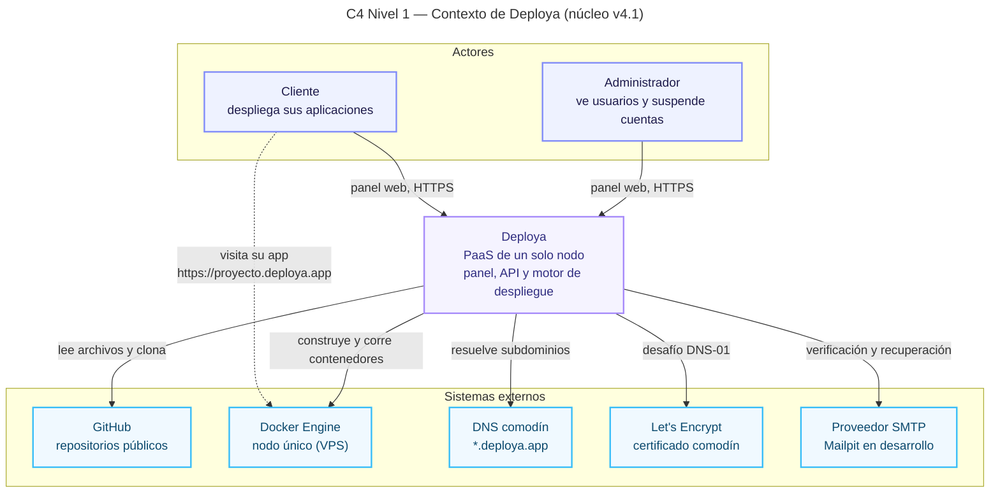

### Contenedores (C4 nivel 2)

| Contenedor | Tecnología | Responsabilidad | Habla con |
|---|---|---|---|
| **web** | Next.js 15 · React 19 · Tailwind 4 | Panel del cliente y del administrador con el design system v4.1. Sondea cada 3 s lo que está en curso | api (HTTPS + cookie) |
| **api** | NestJS 10 · Prisma 6 | Casos de uso de M1, M2, M3, M7, M9 y M10; produce trabajos de M4 y M5. **No habla con Docker** | postgres, redis, GitHub, SMTP |
| **worker** | Misma imagen de la API (`trabajador.ts`) | Consume las colas: clona, construye, ejecuta, publica, muestrea métricas | redis, postgres, Docker, Traefik |
| **postgres** | PostgreSQL 16 | Almacén único de la plataforma | — |
| **redis** | Redis 7 | Colas BullMQ (`despliegues`, operación, muestreo) y señales de cancelación | — |
| **traefik** | Traefik v3.3 | Enrutador de borde: rutas por archivo, TLS comodín, redirección a HTTPS | contenedores de clientes |
| **mailpit** | Mailpit (solo desarrollo) | Atrapa los correos para verlos en el navegador | — |

<!-- diagrama: docs/diagramas/compartido/c4-contenedores.mmd -->
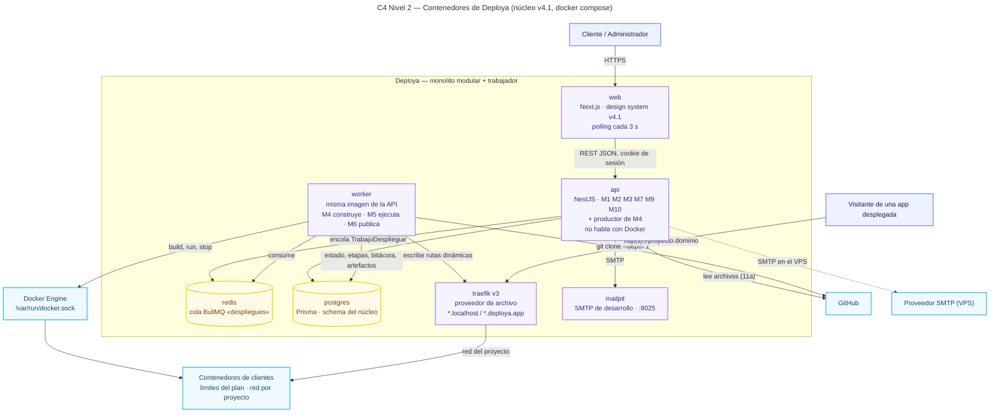

### El ciclo de despliegue

Todo el producto gira alrededor de un ciclo de cinco etapas. Cada una tiene un módulo responsable y un paso del pipeline del trabajador.

| Etapa | Módulo | Paso | Qué produce |
|---|---|---|---|
| Recepción | M4 | `PasoRecepcion` | Clon de la rama, commit registrado, stack detectado |
| Construcción | M4 | `PasoConstruccion` | Imagen `deploya/<subdominio>:<n>` y su artefacto (digest, tamaño, receta) |
| Ejecución | M5 | `PasoEjecucion` | Contenedor con los límites del plan que **pasa la salud** |
| Enrutamiento | M6 | `PasoEnrutamiento` | Ruta de Traefik al contenedor nuevo; el anterior se retira después |
| Operación | M5 / M7 | `PasoOperacion` | Despliegue *Saludable*, versión activa actualizada, oyentes avisados |

Una **reversión** usa el mismo pipeline con otro plan: arranca en *Revirtiendo* y omite Recepción y Construcción, porque la imagen ya existe.

## Arquitectura de cada módulo

### Puertos y adaptadores

Dentro de `apps/api/src/modules/<módulo>/` el código se ordena en cinco anillos. Las flechas de dependencia apuntan siempre hacia dentro: el dominio no conoce a nadie y los adaptadores conocen solo el puerto que implementan.

<!-- diagrama: docs/diagramas/diseno/arquitectura-hexagonal.mmd -->
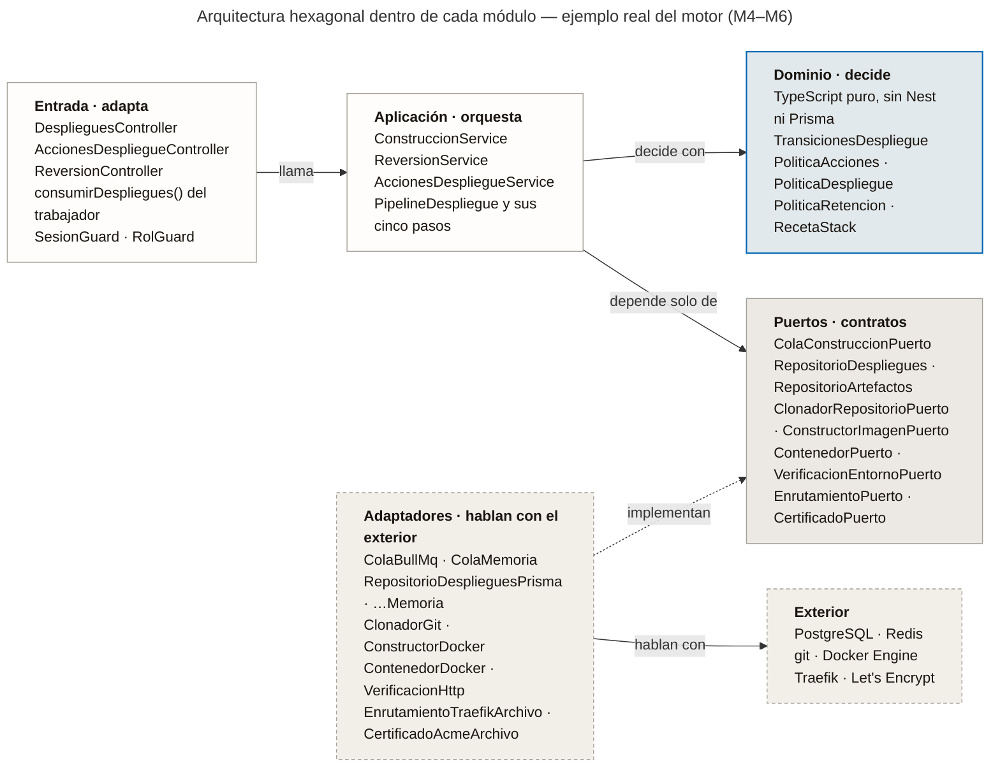

| Capa | Qué vive ahí | Puede depender de | Nunca depende de |
|---|---|---|---|
| **Entrada** | Controladores HTTP, consumidores de cola, guards, filtros de errores | El servicio de su módulo | Prisma, adaptadores |
| **Aplicación** | Servicios que orquestan un caso de uso; el pipeline del motor | Dominio y puertos | Adaptadores concretos |
| **Dominio** | Entidades, objetos valor, políticas y máquinas de estado | Solo TypeScript | Nest, Prisma, Docker, HTTP, `Date.now()` |
| **Puertos** | Contratos que la aplicación necesita, como `abstract class` | Tipos del dominio | Implementaciones |
| **Adaptadores** | Prisma, Docker, BullMQ, Traefik, SMTP, GitHub, memoria y *stubs* | El puerto que implementan | Otros módulos |

> [!IMPORTANT]
> Los puertos son `abstract class` y no `interface` porque en TypeScript la interfaz desaparece al compilar y Nest necesita un valor como token de inyección. No llevan prefijo `I`: se llaman por lo que hacen (`ContenedorPuerto`, `PasarelaPago`, `CorreoPuerto`).

Un puerto real del motor, tal como está en el código:

```ts
/** Puerto DIP — la API no llama a Docker. Sin prefijo I. */
export abstract class ContenedorPuerto {
  abstract crear(espec: EspecContenedor): Promise<ContenedorCreado>;
  abstract iniciar(contenedorId: string): Promise<void>;
  abstract detener(contenedorId: string): Promise<void>;
  abstract eliminar(contenedorId: string): Promise<void>;
  abstract eliminarContenedoresDe(subdominio: string): Promise<void>;
  abstract eliminarImagen(imagen: string): Promise<void>;
  abstract eliminarImagenesDe(subdominio: string): Promise<void>;
  abstract bitacora(contenedorId: string, consulta: ConsultaSalida): Promise<LineaSalida[]>;
}
```

El adaptador se elige **en un solo lugar** y por configuración. Así, `MOTOR_ADAPTADORES=stub` levanta la plataforma completa sin Docker (desarrollo y CI) y `docker` usa los adaptadores reales, sin tocar ningún servicio:

| Puerto | Adaptador real | Doble para pruebas y modo `stub` |
|---|---|---|
| `ColaConstruccionPuerto` | `ColaBullMq` | `ColaMemoria` |
| `ClonadorRepositorioPuerto` | `ClonadorGit` | `ClonadorStub` |
| `ConstructorImagenPuerto` | `ConstructorDocker` | `ConstructorImagenStub` |
| `ContenedorPuerto` | `ContenedorDocker` (dockerode) | `ContenedorStub` |
| `VerificacionEntornoPuerto` | `VerificacionHttp` | `VerificacionEntornoStub` |
| `EnrutamientoPuerto` | `EnrutamientoTraefikArchivo` | `EnrutamientoStub` |
| `CertificadoPuerto` | `CertificadoAcmeArchivo` | `CertificadoAusente` (Null Object) |
| `MetricasContenedorPuerto` | `MetricasDockerStats` | `MetricasContenedorStub` |
| `CorreoPuerto` | `CorreoSmtpAdaptador` (nodemailer) | `CorreoConsolaAdaptador` |
| `PasarelaPago` | `PasarelaSimulada` | La misma (es simulada por diseño) |
| `ProveedorFuente` | `FuenteGitHubPublica` | Dobles en las pruebas |
| `RepositorioDespliegues`, `RepositorioProyectos`… | `…Prisma` | `…Memoria` |

`adapters/stubs/contratos-stubs.spec.ts` comprueba, método por método, que el *stub* y el adaptador real exponen el mismo contrato: es la prueba de Liskov hecha código.

### Módulos y contratos entre ellos

Un módulo solo usa lo que otro **exporta** en su `*.module.ts`, y casi siempre a través de un puerto del consumidor: M3 no importa el servicio de M2, declara `CuotaProyectosPuerto` y un adaptador lo resuelve contra M2. Los datos que cruzan módulos están firmados en `docs/contratos/`.

| Módulo | Expone a otros | Consume de otros (puerto del consumidor) |
|---|---|---|
| M1 Identidad | `SesionGuard`, `RolGuard`, `@UsuarioActual()`, directorio de cuentas | M2 `AsignacionSandboxPuerto`; M10 `CorreoPuerto`; M9 `PoliticaRegistroPuerto` |
| M2 Suscripciones | `cuotaDe(usuarioId)`, catálogo, estado de la suscripción | M5 `ContenedoresClientePuerto` (detener y reanudar); M10 `AvisosPuerto` |
| M3 Proyectos | Lectura de proyectos y variables descifradas | M2 `CuotaProyectosPuerto`; M4 `DeteccionStackService`, `crearDespliegue` |
| M4 Construcción | `crearDespliegue`, vista y bitácora del despliegue, tiempos por etapa | M3 `ProyectosLecturaPuerto`; M5 `BloqueoDespliegue`; M10 `AvisosPuerto` (Observer) |
| M5 Orquestación | Acciones de contenedor, reversión, métricas | M2 `CuotaPlanPuerto`; M3 `VariablesEntornoPuerto` |
| M6 Enrutamiento | `EnrutamientoPuerto`, `CertificadoPuerto` | — |
| M7 Observabilidad | Resumen, historial, consumo, métricas, bitácora de ejecución | M4 y M5 (lectura) |
| M9 Administración | Usuarios, suspensión, instalación, infraestructura | M1 `CuentasSuspensionPuerto`; M5 contenedores |
| M10 Notificaciones | `CorreoPuerto`, `AvisosPuerto` | M1 `DestinatariosPuerto` |

| Contrato | Productor → consumidor | Qué fija |
|---|---|---|
| `datos-nucleo.md` | Prisma → todos | Modelo de datos del núcleo (v2 con métricas) |
| `despliegues.md` | M4/M5 → web | Vista del despliegue, etapas, bitácora, acciones (v2 con reversión) |
| `metricas.md` | M5 → M7 → web | Serie de 1 h y 24 h, picos, eventos |
| `avisos.md` | M2/M4 → M10 | Avisos de despliegue y de suscripción |
| `instalacion.md` | instalador → M1/M9 | Código de configuración, modo, salud de la instalación |

## El motor de despliegue

### Componentes del motor (C4 nivel 3)

<!-- diagrama: docs/diagramas/compartido/c4-componentes-motor.mmd -->
```mermaid
---
title: C4 Nivel 3 — Componentes del motor de despliegue (M4 M5 M6), hexagonal
---
flowchart TB
    WEB["web · pantallas 11a, 12, 13, 14"]
    M3["M3 ProyectosService"]
    M2["M2 SuscripcionesService<br/>cuotaDe(usuarioId)"]

    subgraph ENTRADA["Entrada"]
        CTRL["DesplieguesController<br/>POST /proyectos/:id/despliegues<br/>GET /despliegues/:id · /bitacora?desde="]
        CTRL_V2["AccionesController (v2)<br/>reversiones · cancelar · reintentar<br/>reiniciar · detener · artefactos"]
        PROC["ProcesadorDespliegues<br/>consumidor BullMQ (worker)"]
    end

    subgraph APLICACION["Aplicación"]
        CONS["ConstruccionService<br/>Facade exportada: crearDespliegue,<br/>consultar, bitacoraDesde"]
        DETS["DeteccionStackService<br/>exportado a M3"]
        PIPE["PipelineDespliegue<br/>recorre los pasos del plan"]
        ORQ["OrquestacionService<br/>aprovisionar, activar, detener,<br/>detenerTodosDe"]
        REV["ReversionService (v2)<br/>valida y crea el despliegue"]
        ENR["EnrutamientoService<br/>publicar, retirar"]
        RET["RetencionArtefactos<br/>escucha DespliegueTerminado"]
        PASOS["PasoRecepcion · PasoConstruccion<br/>PasoEjecucion · PasoEnrutamiento<br/>PasoOperacion<br/>Chain of Responsibility"]
    end

    subgraph DOMINIO["Dominio puro"]
        TRANS["TransicionesDespliegue<br/>State"]
        RECETAS["RecetaStack (Strategy)<br/>Dockerfile · Node · Python · Go · Estática<br/>decide sobre un mapa de archivos"]
        POL["PoliticaDespliegue<br/>PoliticaRetencion · LimitesContenedor"]
    end

    subgraph PUERTOS["Puertos (abstract class, sin I)"]
        P_COLA["ColaConstruccionPuerto"]
        P_CLON["ClonadorRepositorioPuerto"]
        P_BUILD["ConstructorImagenPuerto"]
        P_LECT["LectorFuente"]
        P_REPO["RepositorioDespliegues<br/>RepositorioArtefactos"]
        P_CONT["ContenedorPuerto"]
        P_SALUD["VerificacionEntornoPuerto"]
        P_RUTA["EnrutamientoPuerto"]
        P_RELOJ["Reloj"]
    end

    subgraph ADAPTADORES["Adaptadores (y un stub por puerto para pruebas)"]
        A_BULL["ColaBullMq"]
        A_GIT["ClonadorGit"]
        A_DBUILD["ConstructorDocker (dockerode)"]
        A_FS["LectorFuenteLocal · LectorFuenteGitHub (M3)"]
        A_PRISMA["RepositorioDesplieguesPrisma"]
        A_DRUN["ContenedorDocker (dockerode)"]
        A_HTTP["VerificacionHttp"]
        A_TRAEFIK["EnrutamientoTraefikArchivo"]
    end

    REDIS[("Redis")]
    PG[("PostgreSQL")]
    DOCKER["Docker Engine"]
    GIT["GitHub"]
    TRAEFIK["Traefik"]

    WEB --> CTRL
    WEB --> CTRL_V2
    M3 --> CONS
    M3 --> DETS
    CTRL --> CONS
    CTRL_V2 --> REV
    CTRL_V2 --> ORQ
    CONS --> M2
    CONS --> TRANS
    CONS --> POL
    CONS --> P_COLA
    CONS --> P_REPO
    REV --> P_REPO
    REV --> P_COLA
    PROC --> PIPE
    PIPE --> PASOS
    PIPE --> TRANS
    PASOS --> P_CLON
    PASOS --> DETS
    PASOS --> P_BUILD
    PASOS --> ORQ
    PASOS --> ENR
    DETS --> RECETAS
    DETS --> P_LECT
    ORQ --> POL
    ORQ --> M2
    ORQ --> P_CONT
    ORQ --> P_SALUD
    ENR --> P_RUTA
    RET --> POL
    RET --> P_CONT
    PIPE --> P_REPO
    PIPE --> P_RELOJ

    P_COLA -.-> A_BULL
    P_CLON -.-> A_GIT
    P_BUILD -.-> A_DBUILD
    P_LECT -.-> A_FS
    P_REPO -.-> A_PRISMA
    P_CONT -.-> A_DRUN
    P_SALUD -.-> A_HTTP
    P_RUTA -.-> A_TRAEFIK

    A_BULL --> REDIS
    A_PRISMA --> PG
    A_GIT --> GIT
    A_DBUILD --> DOCKER
    A_DRUN --> DOCKER
    A_TRAEFIK --> TRAEFIK

    classDef entry fill:#eef2ff,stroke:#818cf8,stroke-width:2px,color:#1e1b4b
    classDef app fill:#f5f3ff,stroke:#a78bfa,stroke-width:2px,color:#312e81
    classDef dom fill:#f0fdf4,stroke:#4ade80,stroke-width:2px,color:#166534
    classDef port fill:#fff7ed,stroke:#fb923c,stroke-width:2px,color:#7c2d12
    classDef adapter fill:#fdf4ff,stroke:#e879f9,stroke-width:2px,color:#701a75
    classDef ext fill:#f0f9ff,stroke:#38bdf8,stroke-width:2px,color:#0c4a6e
    class CTRL,CTRL_V2,PROC entry
    class CONS,DETS,PIPE,ORQ,REV,ENR,RET,PASOS app
    class TRANS,RECETAS,POL dom
    class P_COLA,P_CLON,P_BUILD,P_LECT,P_REPO,P_CONT,P_SALUD,P_RUTA,P_RELOJ port
    class A_BULL,A_GIT,A_DBUILD,A_FS,A_PRISMA,A_DRUN,A_HTTP,A_TRAEFIK adapter
    class WEB,M3,M2,REDIS,PG,DOCKER,GIT,TRAEFIK ext
```

### El pipeline como cadena de pasos

`PipelineDespliegue` es el corazón del trabajador. Recibe un `TrabajoDespliegue { despliegueId, plan }` de la cola y recorre una **lista ordenada de pasos**. Cada paso conoce su etapa y su estado, y el pipeline hace lo común: valida la transición, marca la etapa en curso, ejecuta, la marca completada y vacía la bitácora.

- **Chain of Responsibility:** los pasos se ejecutan en orden y cada uno deja su resultado en el `ContextoDespliegue` (clon, receta, imagen, contenedor, URL) para el siguiente.
- **Strategy:** cada *plan* es una lista de pasos. `construccion` usa los cinco; `reversion`, los tres últimos. Un plan nuevo no toca ni los pasos ni el pipeline.
- **Compensación (estilo *saga*):** si un paso falla, el pipeline llama a `compensar()` de los que ya corrieron, en orden inverso. Un contenedor que no pasó la salud se borra y la ruta sigue en el anterior. `liberar()` corre siempre (borra el clon temporal).
- **Observer:** al terminar, el pipeline anuncia `DespliegueTerminado` a los `OyenteDespliegue` registrados: `RetencionArtefactos` retira imágenes viejas y `AvisoDespliegueOyente` manda el correo. El pipeline no sabe que existen el correo ni la retención.
- **Cancelación cooperativa:** `VigiaCancelacion` escucha una señal en Redis y aborta el `AbortController` del despliegue; los pasos largos (`git clone`, `docker build`) respetan la señal.

<!-- diagrama: docs/diagramas/diseno/clases-m4-m6-motor.mmd -->
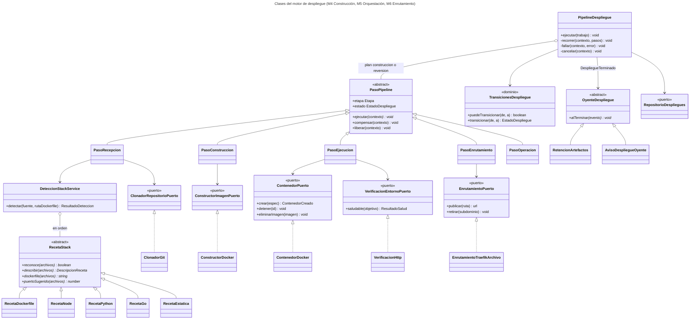

### Máquina de estados del despliegue

Los estados viven en **una sola tabla pura**, `TransicionesDespliegue`. Ningún servicio cambia un estado sin pasar por `transicionar(de, a)`, que lanza `TransicionInvalida` si el cambio no está permitido:

```ts
const SIGUIENTES: Readonly<Record<EstadoDespliegue, readonly EstadoDespliegue[]>> = {
  encolado: ["construyendo", "cancelado"],
  construyendo: ["aprovisionando", "fallido", "cancelado"],
  revirtiendo: ["aprovisionando", "fallido", "cancelado"],
  aprovisionando: ["publicando", "fallido"],
  publicando: ["saludable", "fallido"],
  saludable: ["detenido"],
  detenido: ["aprovisionando"],
  fallido: [],
  cancelado: [],
};
```

<!-- diagrama: docs/diagramas/m1-m10/m4-m5-m6-estados-despliegue.mmd -->
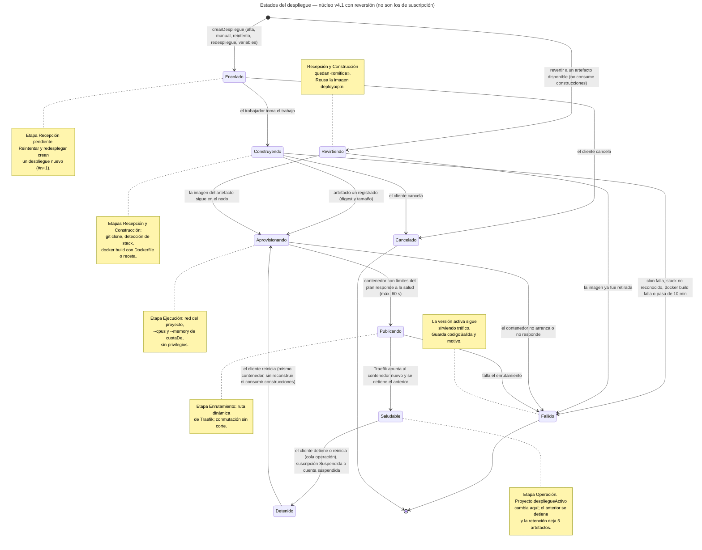

### Detección de stack

<!-- diagrama: docs/diagramas/m1-m10/m4-actividad-deteccion-stack.mmd -->
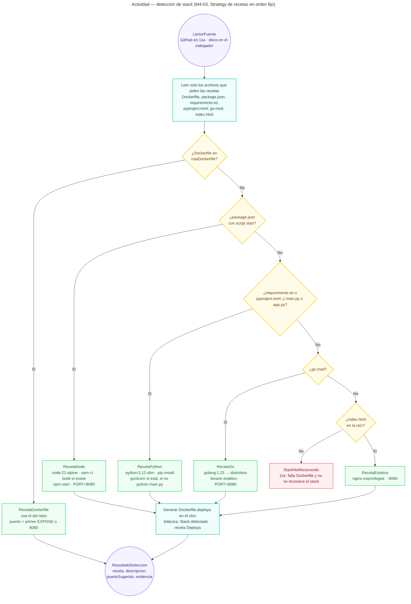

Las recetas son **puras**: deciden sobre un mapa de archivos ya leído. Por eso la misma detección sirve en el alta (M3 lee por la API de GitHub con `LectorFuenteGitHub`) y en el trabajador (lee del clon con `LectorFuenteLocal`). Agregar un stack es crear una clase `RecetaX extends RecetaStack` y registrarla en la lista: **abierto a extensión, cerrado a modificación** ([ADR 0003](../adr/0003-construccion-dockerfile-o-receta.md)).

## Diagramas UML

### Clases · Identidad y notificaciones

`IdentidadService` depende de **nueve** abstracciones y de ninguna implementación. `CorreoConRegistro` es un **Decorator**: envuelve cualquier `CorreoPuerto` para registrar el último envío (lo usa Admin · Instalación) sin que el adaptador SMTP lo sepa. `PlantillaCorreo` es un **Template Method**: `componer()` arma el mensaje con el kit visual y cada plantilla solo define asunto, título, párrafo y botón.

<!-- diagrama: docs/diagramas/diseno/clases-m1-m10-identidad.mmd -->
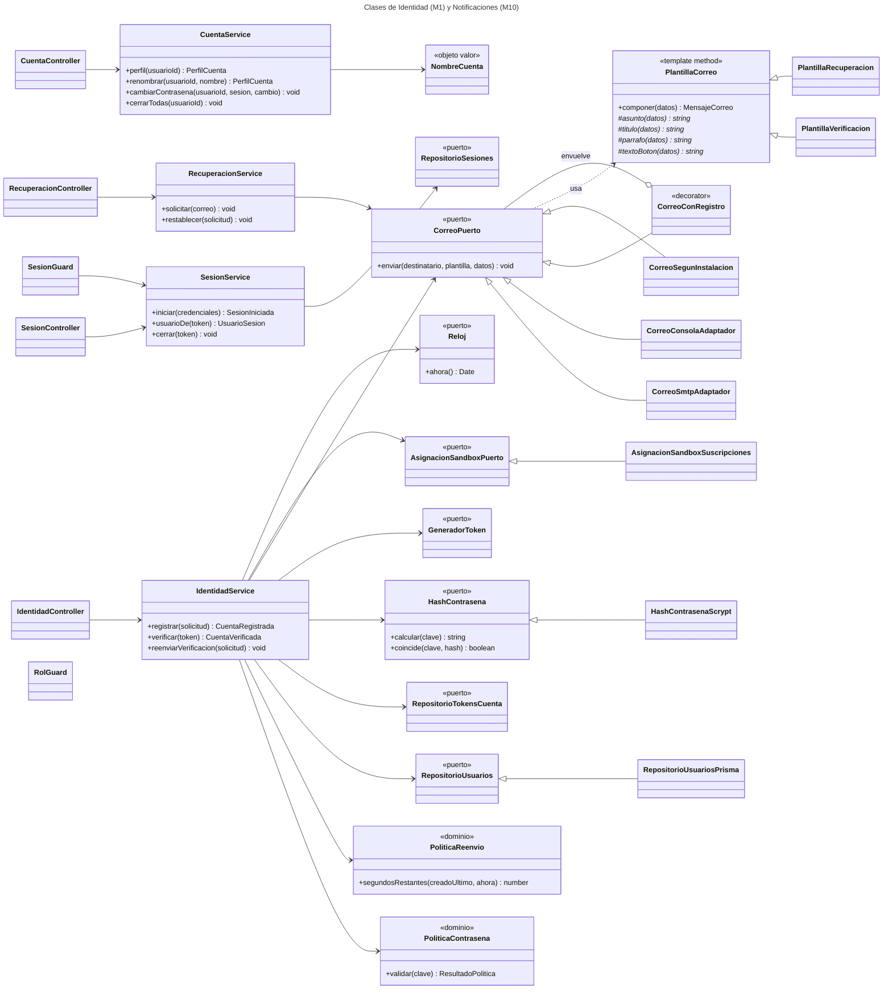

### Clases · Suscripciones y administración

<!-- diagrama: docs/diagramas/m1-m10/m2-m9-clases.mmd -->
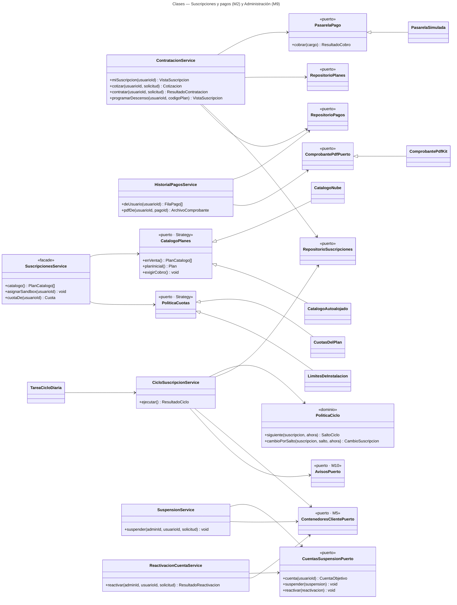

### Clases · Proyectos y observabilidad

<!-- diagrama: docs/diagramas/m1-m10/m3-m7-clases.mmd -->
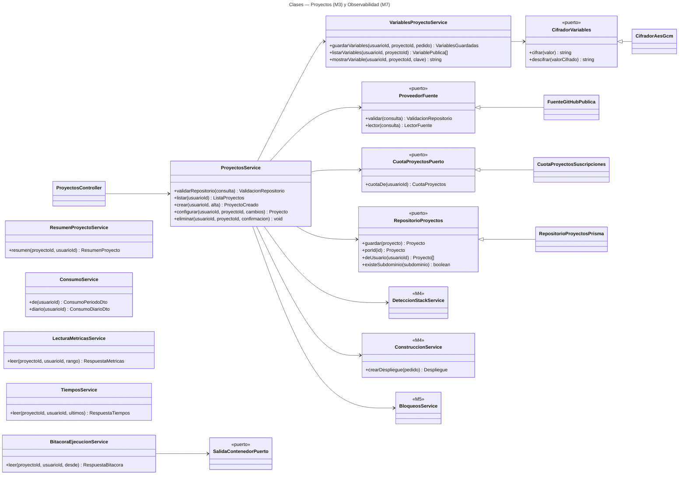

### Secuencia · Recorrido completo

Del registro a la aplicación en línea, cruzando todos los módulos del núcleo.

<!-- diagrama: docs/diagramas/compartido/secuencia-recorrido-e2e.mmd -->
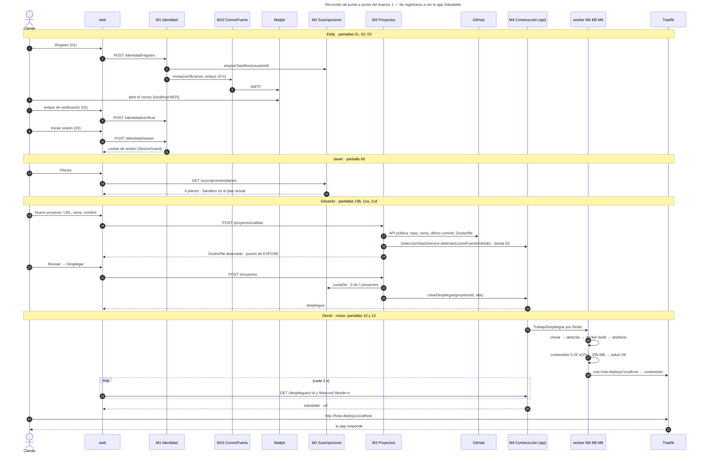

### Secuencia · Contratación de un plan

<!-- diagrama: docs/diagramas/m1-m10/m2-secuencia-contratacion-plan.mmd -->
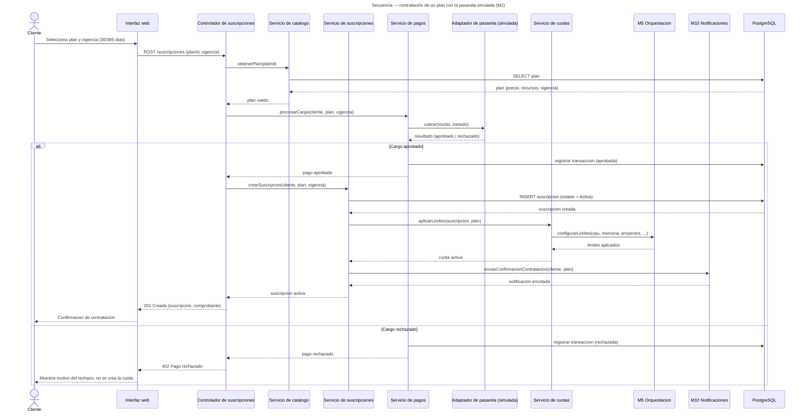

### Secuencia · Despliegue

<!-- diagrama: docs/diagramas/m1-m10/m4-m5-m6-secuencia-despliegue.mmd -->
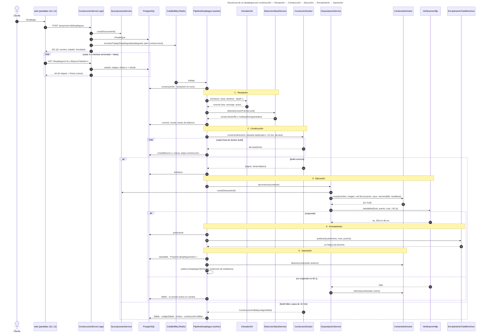

### Secuencia · Reversión sin reconstruir

<!-- diagrama: docs/diagramas/m1-m10/m4-m5-m6-secuencia-reversion.mmd -->
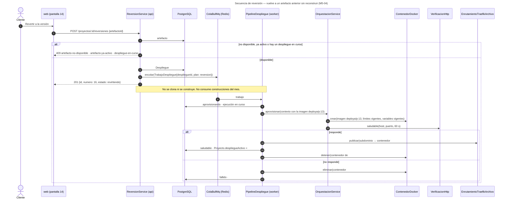

### Estados · Suscripción

`PoliticaCiclo.siguiente(suscripcion, ahora)` es una función pura: recibe la fecha como parámetro, así que el ciclo de 7, 5 y 30 días se prueba con fechas literales y sin esperar. Cada corrida mueve una suscripción **un estado como máximo**, lo que la hace idempotente.

<!-- diagrama: docs/diagramas/m1-m10/m2-estados-suscripcion.mmd -->
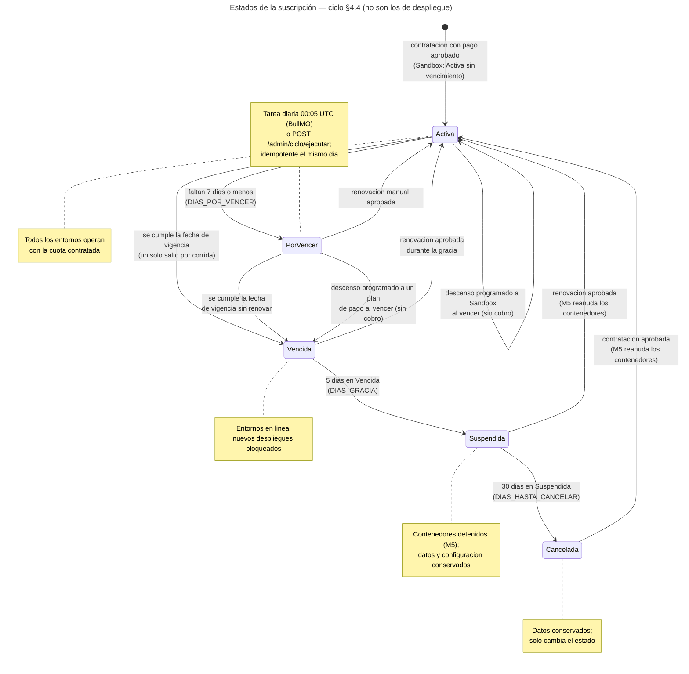

### Actividad · Registro y verificación

<!-- diagrama: docs/diagramas/m1-m10/m1-actividad-registro.mmd -->
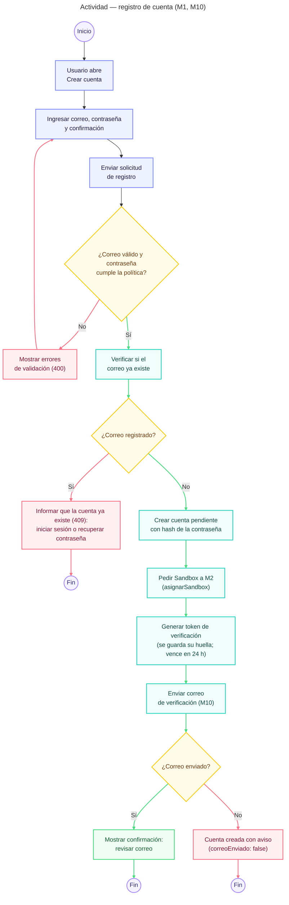

### Actividad · Contratación y activación

<!-- diagrama: docs/diagramas/m1-m10/m2-actividad-contratacion-activacion.mmd -->
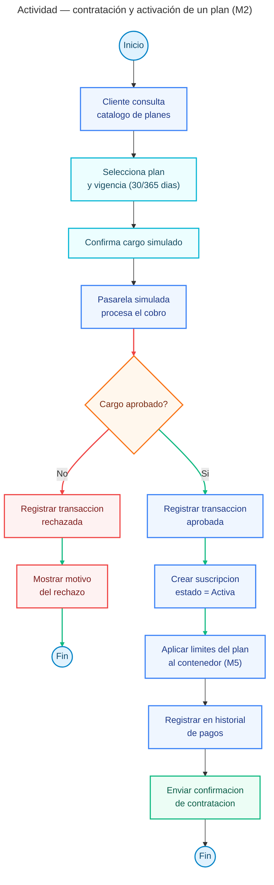

## SOLID aplicado

Cada principio con la regla que sigue el equipo y dónde se puede comprobar en el código.

| Principio | Regla en Deploya | Evidencia en el código |
|---|---|---|
| **S** · Responsabilidad única | El controlador adapta HTTP, el servicio orquesta, la política decide, el adaptador habla con el exterior | `PoliticaCiclo` saca el ciclo de `SuscripcionesService`; `PoliticaRetencion` (decide) y `RetencionArtefactos` (ejecuta) están separadas; un controlador por recurso en M9 |
| **O** · Abierto/cerrado | Se extiende con una implementación nueva, no con `if/switch` por tipo | Recetas de stack (`RecetaNode`, `RecetaPython`…), planes del pipeline, `ManejadorAccion` por acción (`DetenerManejador`, `ReiniciarManejador`, `EliminarManejador`), modo de instalación ([ADR 0008](../adr/0008-autoalojado-y-codigo-abierto.md)) |
| **L** · Sustitución de Liskov | Stub, doble y adaptador real cumplen el mismo contrato y lanzan los mismos errores de dominio | `contratos-stubs.spec.ts`; `CertificadoAusente` devuelve `null` igual que el real sin TLS; `RecetaDockerfile` es una receta más, sin casos especiales |
| **I** · Segregación de interfaces | Puertos estrechos pensados desde quien los usa | ~70 puertos; `VerificacionEntornoPuerto` tiene un solo método; `ProyectosLecturaPuerto` y `DetalleProyectoPuerto` son vistas distintas del mismo repositorio |
| **D** · Inversión de dependencias | Servicios reciben puertos por constructor; nada de `new` de Docker, Prisma, SMTP ni `Date.now()` en el dominio | `IdentidadService` recibe 9 puertos; el tiempo entra por `Reloj`; los bindings viven en `AdaptersModule` y en cada `*.module.ts` |

> [!TIP]
> Los nombres siguen el dominio en español (`Despliegue`, `Suscripcion`, `cuotaDe`) y los sufijos de Nest quedan en inglés (`ConstruccionService`, `ProyectosController`): el diagrama dice `ServicioConstruccion` y el código `ConstruccionService`, y son el mismo componente.

### Clean code

- **Errores de dominio con nombre** en lugar de `Error('x')`: `CorreoYaRegistrado`, `CuotaConstruccionesAgotada`, `TransicionInvalida`, `ArtefactoNoDisponible`, `StackNoReconocido`. Un filtro por módulo los traduce a HTTP (`ErroresIdentidadFilter`, `RechazosOrquestacionFilter`, `ErroresMotorFilter`).
- **Sin números mágicos:** `TIEMPO_MAXIMO_CONSTRUCCION_MS = 10 * 60 * 1000`, `TIEMPO_MAXIMO_SALUD_MS`, `DIAS_POR_VENCER = 7`, `DIAS_GRACIA = 5`, `ESPERA_REENVIO_MS = 60_000`.
- **Tipos estrictos:** sin `any`; lo externo entra como `unknown` y se valida en el borde.
- **Consultas separadas de comandos:** M7 solo lee; el motor escribe.

## Patrones de diseño

| Patrón | Dónde | Clases | Por qué |
|---|---|---|---|
| **Ports & Adapters** (hexagonal) | Todos los módulos | ~70 puertos `abstract class` | El dominio se prueba sin infraestructura y el proveedor se cambia por configuración |
| **Repository** (Fowler) | Persistencia por agregado | `RepositorioUsuarios`, `RepositorioDespliegues`, `RepositorioPagos`… con versión Prisma y en memoria | El servicio no conoce SQL ni Prisma |
| **Adapter** (GoF) | Exterior | `ContenedorDocker`, `EnrutamientoTraefikArchivo`, `FuenteGitHubPublica`, `CorreoSmtpAdaptador` | Traducir una API externa al contrato del puerto |
| **Strategy** | Pagos, recetas, planes del pipeline, modo de instalación | `PasarelaPago`, `RecetaStack`, `PlanesPipeline`, `CatalogoPlanes`, `PoliticaCuotas` | Variar el algoritmo sin tocar a quien lo usa |
| **State** (tabla pura) | Despliegue y suscripción | `TransicionesDespliegue`, `PoliticaCiclo` | Una sola fuente de verdad de las transiciones, probada sin base |
| **Chain of Responsibility** | Motor | `PasoPipeline` y sus cinco pasos | Cada etapa es una clase con su compensación |
| **Command** + productor/consumidor | Colas | `TrabajoDespliegue`, acciones de operación | Construir fuera del ciclo HTTP; `jobId = despliegueId` lo hace idempotente |
| **Observer** | Fin de un despliegue | `OyenteDespliegue` ← `RetencionArtefactos`, `AvisoDespliegueOyente` | El pipeline no depende del correo ni de la retención |
| **Decorator** | Correo | `CorreoConRegistro` envuelve un `CorreoPuerto` | Registrar envíos sin tocar el adaptador SMTP |
| **Template Method** | Plantillas de correo | `PlantillaCorreo.componer()` | Mismo kit visual; cada correo define solo su texto |
| **Null Object** | Certificado sin TLS | `CertificadoAusente` | La vista no pregunta si hay TLS |
| **Facade** | Fronteras entre módulos | `SuscripcionesService.cuotaDe`, `asignarSandbox` | Una sola puerta por módulo |
| **Composite** | Salud de la instalación | `SaludInstalacion` y sus comprobaciones | Un estado general a partir de varias comprobaciones |
| **Guard / Decorator de Nest** | Autorización | `SesionGuard`, `RolGuard`, `@Roles()`, `@UsuarioActual()` | La autorización no ensucia los controladores |
| **Container / Presentational** | Web | Hooks (`useDespliegue`) y componentes sin `fetch` | La lógica de la web se prueba con `node --test` |

## Modelo de datos

### Modelo entidad-relación

Dieciséis tablas en PostgreSQL. El modelo se agrupa por el módulo dueño de cada tabla; las relaciones que cruzan módulos (`Usuario → Proyecto`, `Plan → Suscripcion`) están firmadas en `docs/contratos/datos-nucleo.md`.

<!-- diagrama: docs/diagramas/compartido/erd-unificado.mmd -->
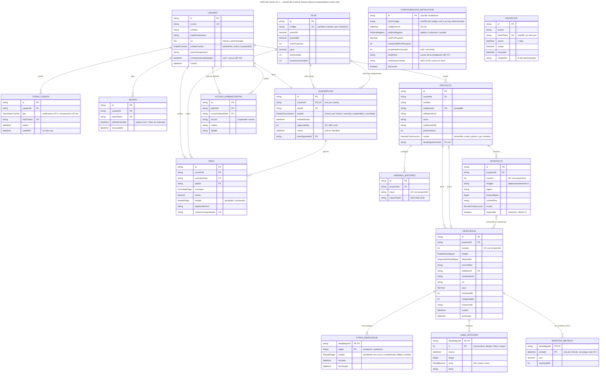

### Decisiones de diseño de la base

| Decisión | Por qué |
|---|---|
| Claves primarias `uuid` generadas por la aplicación | No revelan volumen ni orden; se pueden crear antes de insertar (el despliegue y su trabajo comparten id) |
| Claves naturales únicas aparte del `id` | `Usuario.correo`, `Plan.codigo`, `Proyecto.subdominio`, `Pago.numeroComprobante`: el *seed* es idempotente por clave natural |
| Únicas compuestas donde el dominio lo pide | `(proyectoId, numero)` en `Despliegue` y `Artefacto`; `(usuarioId, nombre)` en `Proyecto`; `(proyectoId, clave)` en `VariableEntorno` |
| Claves compuestas sin `id` artificial | `EtapaDespliegue (despliegueId, etapa)`, `LineaBitacora (despliegueId, n)`, `MuestraMetrica (despliegueId, tomada)`: son series que se leen siempre por su despliegue |
| Dinero en `numeric(10,2)` y moneda `char(3)` | Nada de flotantes para importes |
| Enums de PostgreSQL para los estados | La base rechaza un estado que no existe; los valores coinciden con el contrato (`por-vencer`, `en-curso`) |
| Borrado en cascada desde el agregado raíz | Eliminar un proyecto borra variables, despliegues, etapas, bitácora, artefactos y muestras; eliminar un usuario borra todo lo suyo |
| `SetNull` en referencias débiles | `Proyecto.despliegueActivoId` y `Despliegue.artefactoId` no bloquean el borrado del otro lado |
| Índices por la consulta que los usa | `(estado, vence)` para el ciclo diario; `(usuarioId, creado)` para el historial de pagos; `(proyectoId, creado)` para el historial de despliegues; `tomada` para purgar métricas |
| Secretos nunca en claro | Contraseñas con `scrypt`; tokens solo como SHA-256; variables y SMTP con AES-256-GCM |
| Una fila de configuración | `ConfiguracionInstalacion.id = "instalacion"` garantiza una sola configuración en autoalojado |

**Migraciones:** siete migraciones de Prisma versionadas en `apps/api/prisma/migrations` (núcleo del 29 de septiembre, más métricas, configuración de la instalación, fecha de cambio de contraseña, invitaciones y correo de la instalación). `prisma migrate deploy` las aplica en orden y el servicio `migracion` de compose las corre antes que la API.

### Diccionario de datos

Generado desde `apps/api/prisma/schema.prisma` cada vez que se construye este documento, así que no puede desfasarse del modelo real. Claves: **PK** primaria, **FK** foránea, **UQ** única.

<!-- diccionario-datos -->

## Seguridad por diseño

| Amenaza (STRIDE) | Dónde podría ocurrir | Control |
|---|---|---|
| **S**uplantación | Robo de sesión | Cookie `HttpOnly` + `SameSite=Lax` + `Secure`; en la base solo la huella SHA-256 del token; cambiar o restablecer la contraseña revoca sesiones |
| **S**uplantación | Fuerza bruta de credenciales | Política de 12 caracteres; límite de intentos por IP en el código de configuración (y en el inicio de sesión con EST-01a) |
| **T**ampering | Variables del cliente alteradas en la base | AES-256-GCM: un valor alterado falla la autenticación y el despliegue falla sin tocar la versión activa |
| **R**epudio | Acciones del administrador | `AccionAdministrativa` registra quién, a quién, qué, motivo y cuándo |
| **I**nformation disclosure | Enumerar cuentas o recursos | Respuestas neutras en registro y recuperación; 404 (no 403) para recursos ajenos; la bitácora nunca muestra valores de variables |
| **D**enial of service | Un cliente acapara el nodo | `--cpus` y `--memory` del plan; construcciones por mes; concurrencia 1 en el trabajador; tiempo máximo de 10 min por construcción |
| **E**levation of privilege | Escapar del contenedor o llegar a Docker | Contenedores sin privilegios, `CapDrop: ALL`, `no-new-privileges`, red propia; solo el trabajador monta `docker.sock`; nombres reservados (`api`, `www`) prohibidos como subdominio |

## Infraestructura y despliegue

### Diagrama de despliegue

<!-- diagrama: docs/diagramas/compartido/despliegue-infraestructura.mmd -->
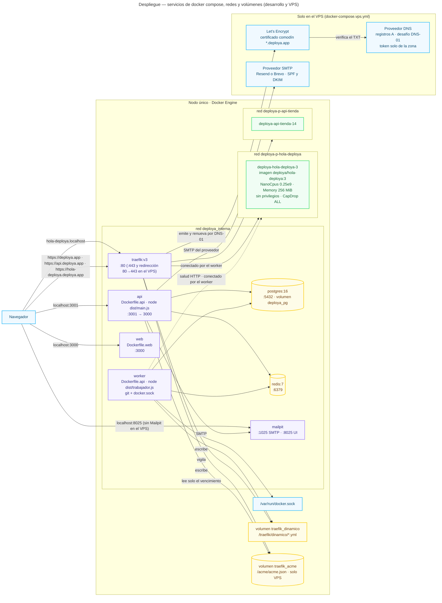

### Entornos

| Entorno | Cómo se levanta | Motor | Correo | Dominio |
|---|---|---|---|---|
| Pruebas unitarias y CI | `pnpm test` | En memoria | Consola | — |
| Desarrollo | `docker compose up` | Docker real | Mailpit | `http://<proyecto>.localhost` |
| VPS (demostración) | `scripts/desplegar-vps.sh` | Docker real | Proveedor SMTP | `https://<proyecto>.deploya.app` con comodín |
| Autoalojado | `scripts/instalar.sh` | Docker real | El que configure el administrador | El dominio de quien instala |

## Diseño de la interfaz

La web sigue el **design system Deploya v4.1** (`docs/diseno/`), el mismo con el que está hecho este documento. Sus reglas tienen consecuencias de diseño concretas:

| Principio | Qué significa en la interfaz |
|---|---|
| **Sobrio en la forma, vivo en el estado** | La personalidad está en cómo se ve lo que pasa: el riel de cinco etapas y el cursor de la bitácora |
| **Claro por defecto**, oscuro siempre disponible | Toggle en el encabezado; cada pantalla se revisa en ambos |
| **Neutros cálidos y una sola tinta** | Papel en claro y grafito en oscuro; nada de paletas por módulo |
| **Señal = lo que está en curso** | El azul solo marca la etapa actual, *Construyendo*, lo no leído y el foco |
| **Bordes antes que sombras** | La sombra se reserva para diálogos y menús |
| **Geist para hablar, Geist Mono para medir** | Hashes, dominios, variables, puertos y tiempos van en monoespaciada |
| **Informa, no decora** | Sin gradientes ni emoji; ilustraciones solo en las pantallas de acceso |

Los tokens se definen una vez en `apps/web/src/app/globals.css` en OKLCH (colores perceptualmente uniformes) y los componentes viven en `apps/web/src/components`, con un catálogo vivo en `/sistema`. La interfaz tiene **45 fichas de pantalla** (una por artboard del canvas), y cada estado lleva palabra e icono, nunca solo color.

| Token | Uso | Muestra |
|---|---|---|
| `foreground` / `primary` | Tinta y botón principal | <span class="estado neutro">Tinta</span> |
| `signal` | Solo lo que está en curso | <span class="estado curso">Construyendo</span> |
| `ok` | Saludable, Activa | <span class="estado ok">Saludable</span> |
| `warn` | Por vencer, Vencida, límite cerca | <span class="estado warn">Por vencer</span> |
| `bad` | Fallido, Suspendida, errores | <span class="estado bad">Fallido</span> |

## Decisiones de arquitectura

Cada decisión grande tiene su registro con contexto, alternativas y consecuencias (formato de Michael Nygard) en `docs/adr/`.

| ADR | Decisión | Alternativa descartada principal |
|---|---|---|
| [0001](../adr/0001-correo-por-smtp-configurable.md) | Correo por un adaptador SMTP configurable; Mailpit solo en desarrollo | Un SDK por proveedor |
| [0002](../adr/0002-cola-bullmq-y-trabajador-aparte.md) | Cola BullMQ y un trabajador aparte con la misma imagen | Construir dentro de la API |
| [0003](../adr/0003-construccion-dockerfile-o-receta.md) | `Dockerfile` del repositorio o receta por stack detectado | Buildpacks (Nixpacks, Paketo) |
| [0004](../adr/0004-versionado-y-reversion-sin-reconstruir.md) | Artefactos inmutables y reversión sin reconstruir, retención de 5 | Registro de imágenes aparte |
| [0005](../adr/0005-traefik-proveedor-de-archivo.md) | Traefik v3 con proveedor de archivo y una red por proyecto | Etiquetas de Docker |
| [0006](../adr/0006-polling-en-vez-de-websocket.md) | *Polling* cada 3 s en vez de WebSocket o SSE | WebSocket |
| [0007](../adr/0007-certificado-comodin-por-dns-01.md) | Certificado comodín por DNS-01 | HTTP-01 por proyecto |
| [0008](../adr/0008-autoalojado-y-codigo-abierto.md) | Código abierto (AGPL-3.0) y autoalojado por Strategy de puertos | Un fork para autoalojado |
| [0009](../adr/0009-monolito-modular-hexagonal.md) | Monolito modular hexagonal y TypeScript de punta a punta | Microservicios |

## Calidad y pruebas

<div class="metricas">
<div class="metrica"><b>1 069</b><span>pruebas de la API en 146 suites</span></div>
<div class="metrica"><b>272</b><span>pruebas de lógica de la web</span></div>
<div class="metrica"><b>96.8 %</b><span>líneas cubiertas en la API</span></div>
<div class="metrica"><b>42</b><span>changes de OpenSpec archivados</span></div>
</div>

| Nivel | Herramienta | Qué cubre |
|---|---|---|
| Unitarias de dominio y servicios | Jest + `@nestjs/testing` | Un `it(...)` por escenario del spec, con puertos dobles y `Reloj` falso |
| Contratos de adaptadores | Jest | Stub y real con los mismos métodos (`contratos-stubs.spec.ts`) |
| Lógica de la web | `node --test` | Formato, validaciones, fusión de bitácora, acciones por fila |
| *Smoke* de compose | GitHub Actions + `e2e/smoke.mjs` | La plataforma completa arranca y responde |
| Recorrido e2e | `e2e/recorrido.mjs` (QA-01, se suma en esta entrega) | Registro → verificación → sesión → plan → proyecto → despliegue, y sus negativos |
| Seguridad del repositorio | `gitleaks`, `shellcheck` | Sin secretos en el historial; scripts del instalador sin errores |

Cada PR corre el job **Build y pruebas** (pruebas, build y validación de diagramas), **Secretos**, **Scripts** y **Smoke compose**. Nada entra a `main` sin pasar por PR y por la revisión del dueño del módulo (`CODEOWNERS`).
