# Manual de usuario · Deploya v1.0.0 (DOC-01)

Cómo usar Deploya como **Cliente** (publicar y operar tus aplicaciones) y como **Administrador** (usuarios, suspensiones e infraestructura). En la nube la dirección es `https://<dominio>`; en local, `http://localhost:3000`.

> Las capturas son de la v1.0.0 corriendo con `docker compose` y el seed de demo, en tema claro (el botón de luna arriba a la derecha cambia a oscuro). En el VPS se ven igual, con tu dominio y HTTPS. Están en [capturas/](capturas/).

## 1. Cliente

### 1.1 Crear la cuenta y entrar

1. Abre **Crear cuenta** (`/registro`). Escribe tu correo y una contraseña de al menos 12 caracteres con mayúsculas, minúsculas, un número y un símbolo; la lista de requisitos se marca mientras escribes.
2. Deploya te manda el correo **«Confirma tu correo en deploya»**. Abre el enlace (vale 24 horas y se usa una sola vez). Si no te llegó, en `/verificar` puedes pedir otro cuando termine la cuenta atrás.
3. Entra en **Iniciar sesión** (`/ingresar`). Si te equivocas de contraseña cinco veces seguidas, la pantalla dice **«Demasiados intentos. Vuelve a intentar en N min.»**: espera esos minutos.
4. ¿Olvidaste la contraseña? **Olvidé mi contraseña** (`/recuperar`) manda un enlace de 30 minutos. Al cambiarla se cierran tus otras sesiones.

| Registro (01) | Iniciar sesión (03) |
|---|---|
| 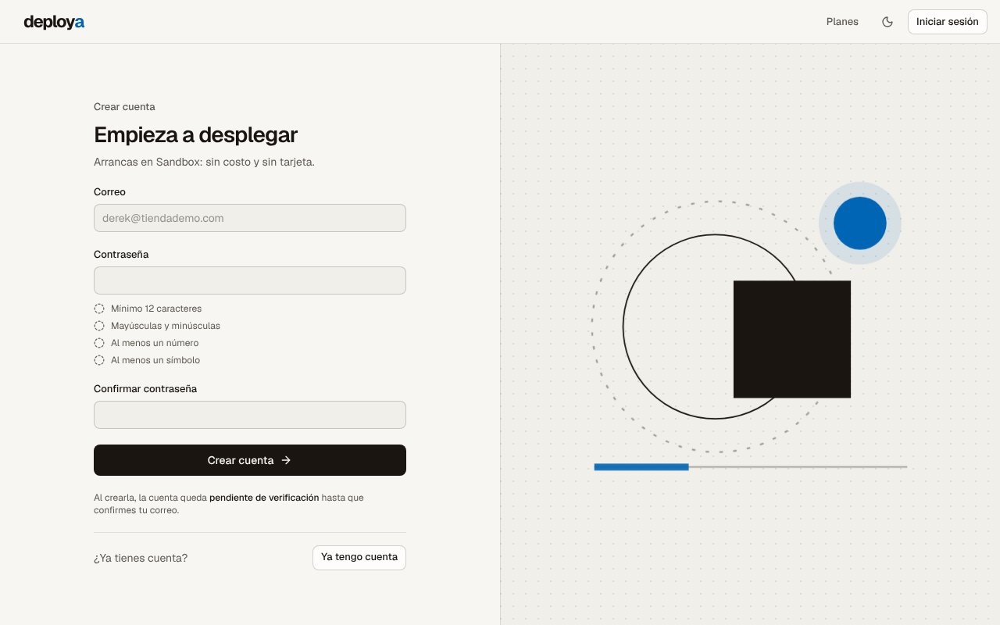 | 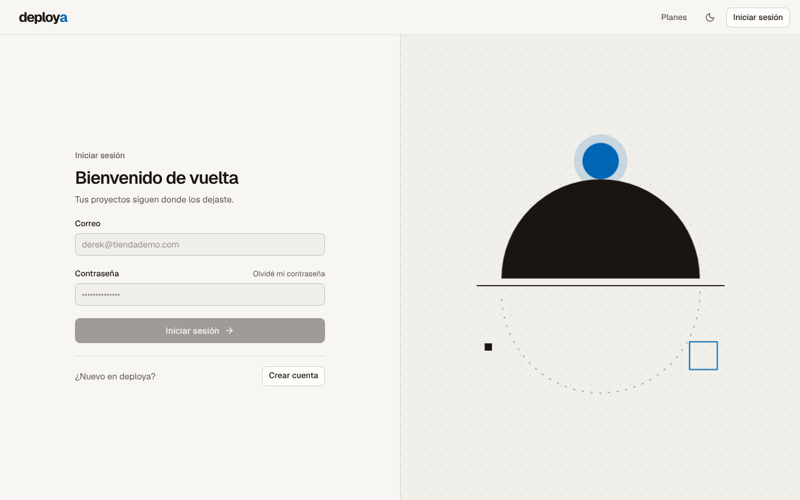 |

Toda cuenta nueva empieza en **Sandbox**: gratis, sin tarjeta, un proyecto con 0.25 vCPU y 256 MB.

### 1.2 Planes y pagos

| Plan | 30 días | 365 días | Proyectos | CPU | Memoria | Construcciones al mes |
|---|---|---|---|---|---|---|
| Sandbox | gratis | — | 1 | 0.25 vCPU | 256 MB | 30 |
| Starter | USD 6 | USD 60 | 3 | 0.5 vCPU | 512 MB | 150 |
| Pro | USD 19 | USD 190 | 10 | 1 vCPU | 1 GB | 500 |
| Business | USD 49 | USD 490 | 25 | 2 vCPU | 2 GB | 2 000 |

1. **Planes** (`/planes`) → elige un plan y la vigencia → **Contratar**.
2. El pago es **simulado** (no se cobra nada). Tarjetas de prueba:
   - `4242 4242 4242 4242` → aprobado.
   - `4000 0000 0000 0002` → rechazado por fondos insuficientes.
   - `4000 0000 0000 3220` → aprobado tras unos segundos (pago lento).
   - Vencimiento cualquier `MM/AA` y CVC de 3 dígitos.
3. Con el pago aprobado el plan se aplica **al instante**. En **Suscripción** (`/suscripcion`) ves la vigencia, el consumo del período, el **ritmo de construcciones** y puedes renovar o cambiar de plan. En **Historial de pagos** (`/pagos`) descargas cada comprobante en PDF.

| Planes (06) | Mi suscripción (08) | Historial de pagos (09) |
|---|---|---|
| 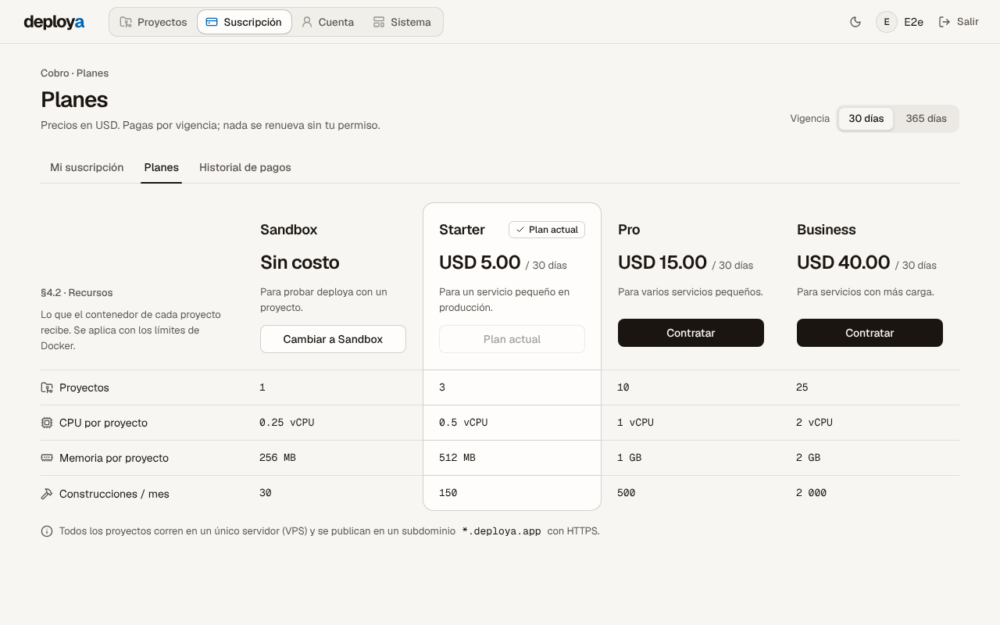 | 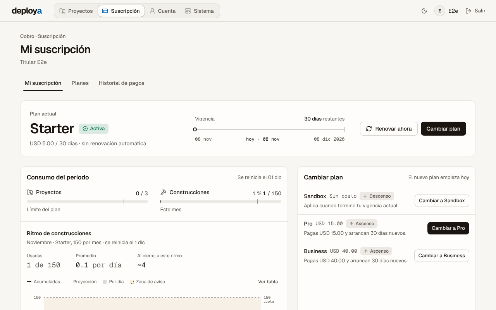 | 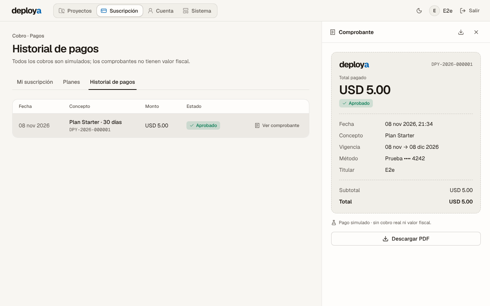 |

**Si tu plan vence:** los servicios siguen en línea 5 días de gracia, pero no puedes desplegar ni crear proyectos (aviso en **Proyectos**). Si no renuevas, la suscripción se suspende y tus contenedores se detienen; renovar los vuelve a levantar. Te llegan correos antes de vencer y al suspenderse.

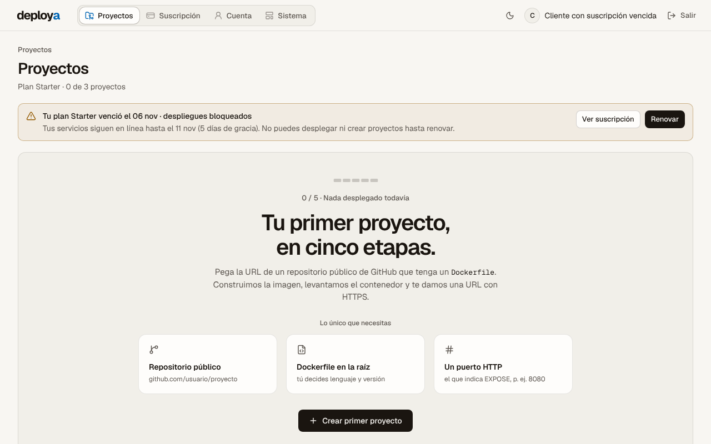

### 1.3 Publicar una aplicación

Necesitas un **repositorio público de GitHub** con un `Dockerfile` en la raíz **o** con un stack que Deploya reconoce: Node (`package.json`), Python (`requirements.txt` o `pyproject.toml`), Go (`go.mod`) o un sitio estático (`index.html`).

1. **Proyectos** → **Nuevo proyecto**.
2. Pega la URL (`https://github.com/usuario/proyecto`), elige la rama y pulsa **Continuar**. Deploya comprueba que el repositorio es accesible y te dice qué encontró: «Dockerfile» o **«Stack detectado: Node.js 22 · receta Deploya»**, y el puerto.
3. Opcional: agrega variables de entorno (se guardan cifradas).
4. **Revisar** → **Desplegar**.

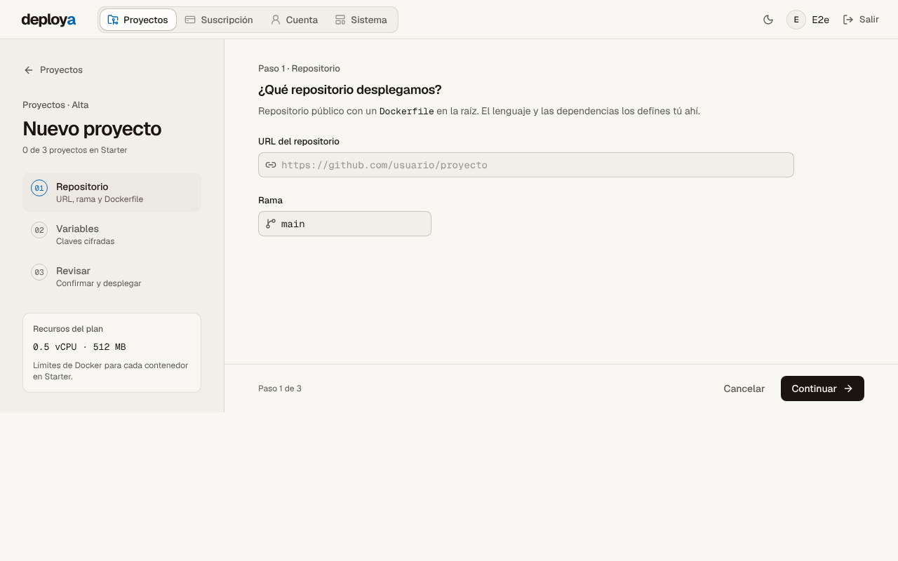

El despliegue avanza por cinco etapas con su bitácora en vivo: **Recepción → Construcción → Ejecución → Enrutamiento → Operación**. Cuando pasa la verificación de salud queda **Saludable** y el botón **Visitar** abre `https://<proyecto>.<dominio>` con su candado. Te llega un correo «<proyecto> está en línea».

Si falla, la pantalla resalta la línea del error en la bitácora; si había una versión anterior Saludable, **sigue sirviendo el tráfico**. Corrige el repositorio y vuelve a desplegar.

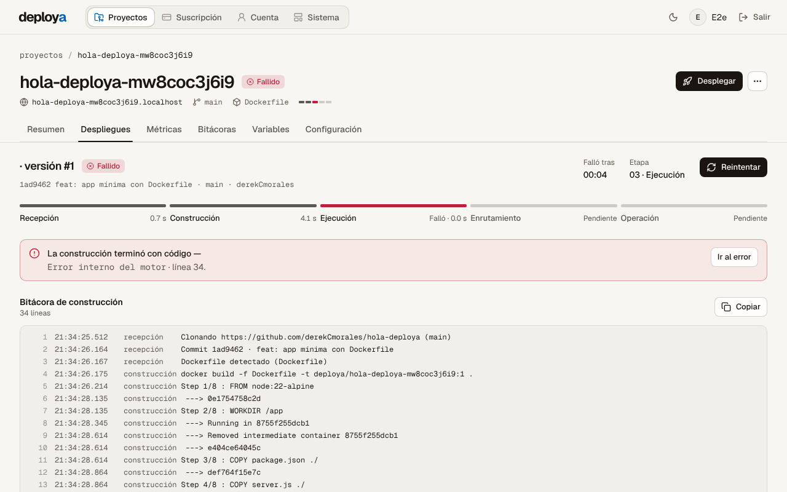

### 1.4 Operar el proyecto

Cada proyecto tiene sus pestañas:

| Pestaña | Para qué |
|---|---|
| **Resumen** (13) | Estado actual, recursos aplicados (CPU y memoria del plan), último despliegue y las últimas 24 h |
| **Despliegues** (14) | Historial numerado. **Revertir** a una versión anterior la vuelve a poner en segundos **sin reconstruir** (no gasta construcciones). También tiempo por etapa |
| **Métricas** (16) | CPU y memoria del contenedor con marcas por despliegue |
| **Bitácoras** (15) | La salida de tu aplicación en vivo; se puede pausar y descargar |
| **Variables** (17) | Agregar, cambiar o borrar variables; aplican en el próximo despliegue o al guardar con «Guardar y desplegar» |
| **Configuración** (19) | Rama, puerto, reiniciar, detener y **Eliminar proyecto** (pide escribir el nombre) |

El botón **Desplegar** de arriba crea una versión nueva desde el último commit de la rama. Mientras uno está en Construcción puedes **cancelarlo**.

| Resumen (13) | Despliegues (14) |
|---|---|
| 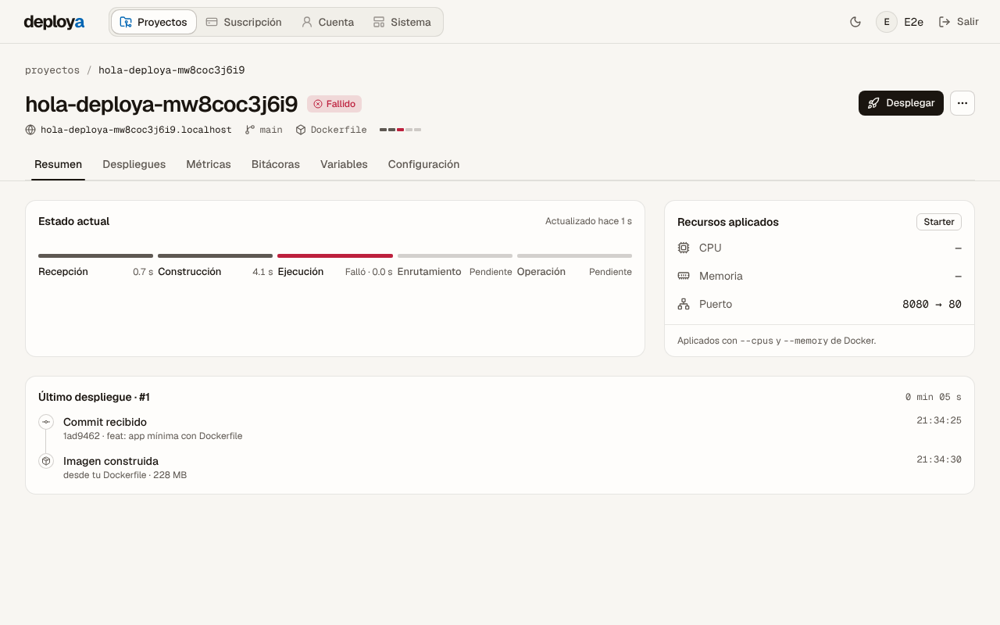 | 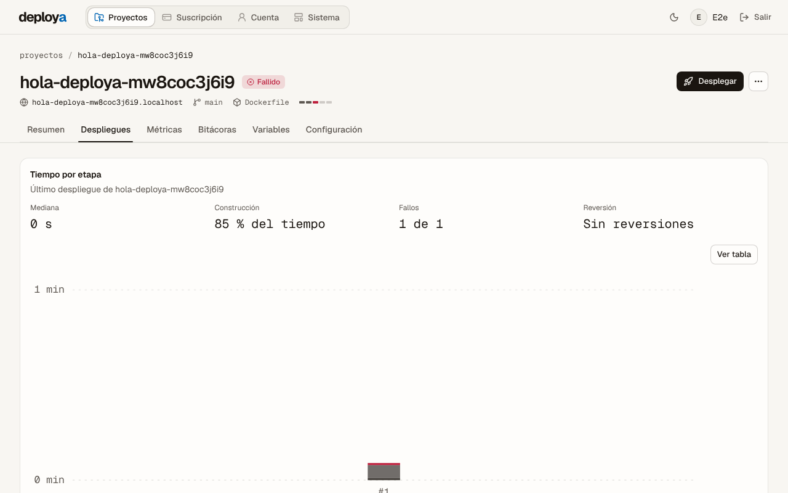 |

| Métricas (16) | Variables (17) | Configuración (19) |
|---|---|---|
| 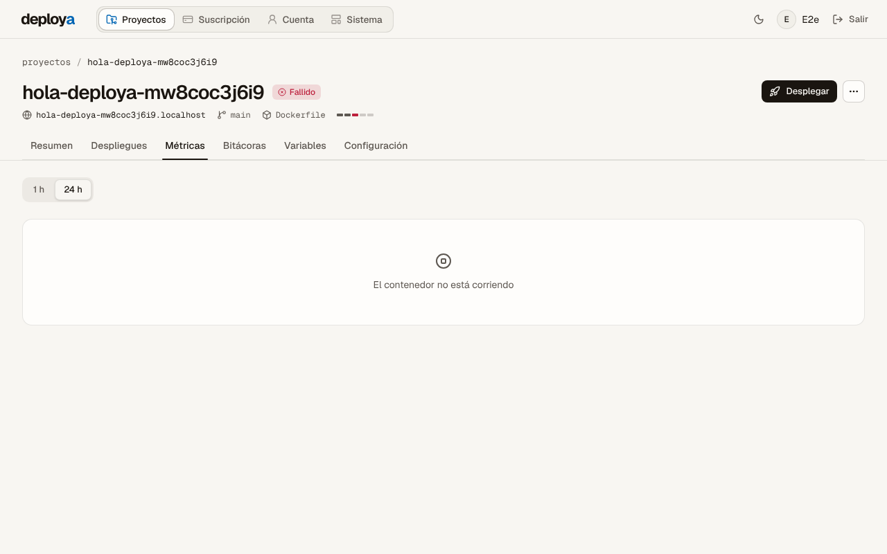 | 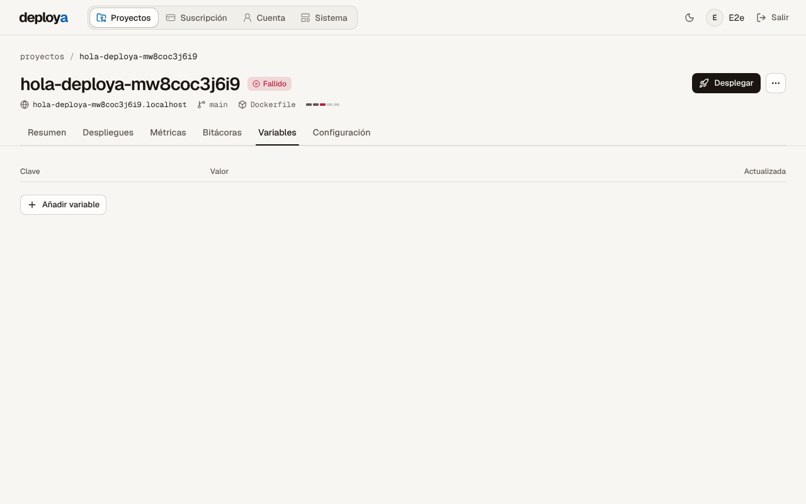 | 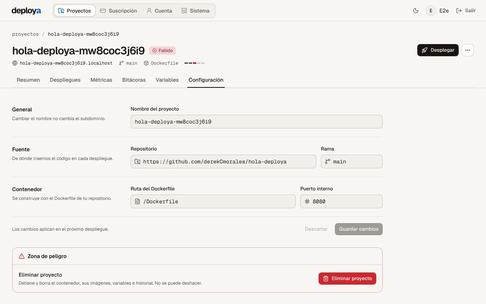 |

### 1.5 Mi cuenta

**Cuenta** (`/cuenta`): tu nombre y correo. **Seguridad** (`/cuenta/seguridad`): cambiar la contraseña (muestra el «Último cambio»), ver tus sesiones abiertas y **Cerrar todas** las demás.

| Mi cuenta (05) | Seguridad (05b) |
|---|---|
| 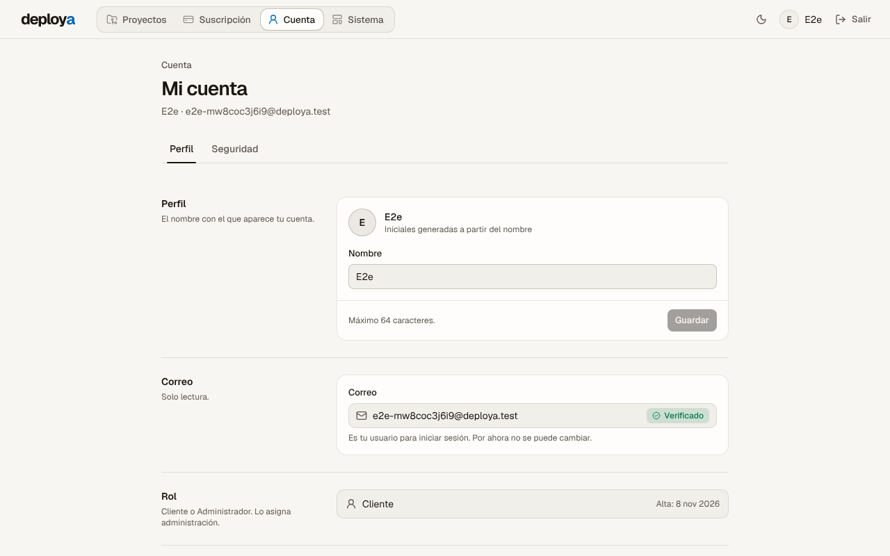 | 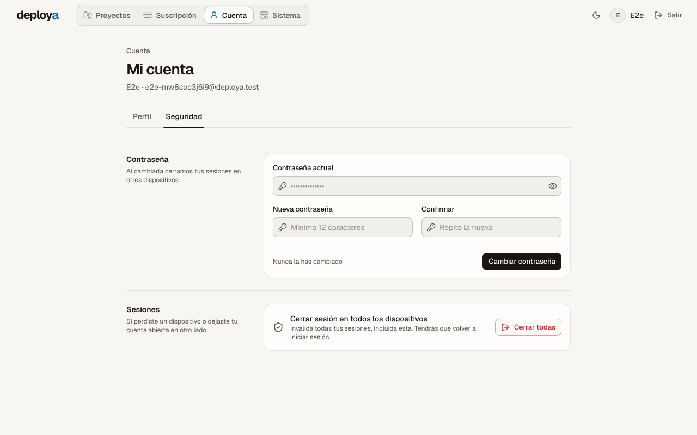 |

## 2. Administrador

En la nube la cuenta de administración la crea el seed (`ADMIN_CORREO`); en autoalojado, el asistente de primera configuración. Al entrar aparecen **Administración** e **Infraestructura** en la barra.

### 2.1 Usuarios, suspender y reactivar

1. **Administración** (`/admin/usuarios`): busca por correo y filtra por estado de la suscripción. Al elegir un usuario se abre su detalle: suscripción, proyectos con su estado y pagos.
2. **Suspender cuenta**: elige un motivo de la lista y, si quieres, un detalle. Sus contenedores se detienen al momento y al iniciar sesión verá «Cuenta suspendida por administración» con el motivo. Los datos se conservan y queda registro de la acción.
3. **Reactivar cuenta**: escribe el motivo; los contenedores vuelven en unos segundos.

| Usuarios (25) | Detalle y suspender (25b) |
|---|---|
|  | 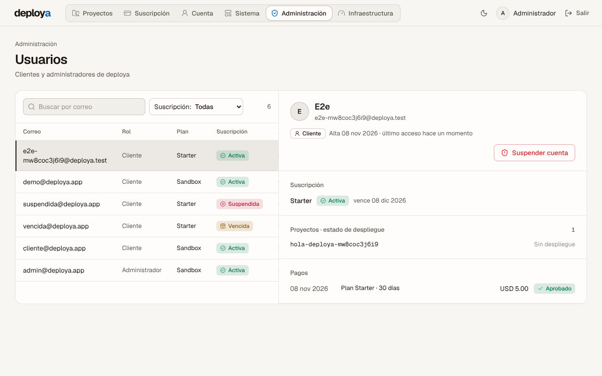 |

### 2.2 Infraestructura

**Infraestructura** (`/admin/infraestructura`, solo lectura): CPU, memoria y disco del servidor; la cola de construcción (en espera, en curso y fallidas en 24 h) y la tabla de entornos con la última muestra de CPU y memoria de cada uno.

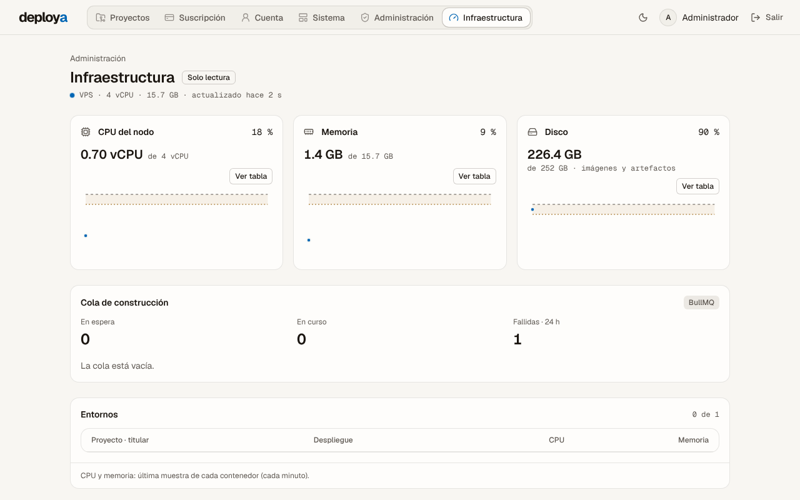

### 2.3 Tareas diarias

| Tarea | Cuándo | A mano |
|---|---|---|
| Ciclo de la suscripción §4.4 (vencer, suspender, cancelar y avisos) | 00:05 UTC | `POST /admin/ciclo/ejecutar` |
| Limpieza de tokens, sesiones e invitaciones vencidas | 00:35 UTC | `POST /admin/limpieza/ejecutar` |

Las dos son idempotentes: correrlas dos veces el mismo día no cambia nada la segunda vez. En autoalojado, **Admin · Instalación** (32) muestra la última limpieza y el último respaldo, la política de registro (abierto, con invitación o cerrado), las invitaciones y los límites por proyecto.

## 3. Preguntas frecuentes

| Pregunta | Respuesta |
|---|---|
| No me llega el correo de verificación | Revisa spam y pide otro en `/verificar` cuando termine la cuenta atrás. Se mandan como máximo 3 por hora |
| «Repositorio no accesible» | Debe ser **público** y la URL de la forma `https://github.com/usuario/proyecto` |
| «Necesitas un Dockerfile o un stack reconocido» | Agrega un `Dockerfile` o el archivo del stack (`package.json`, `requirements.txt`, `go.mod`, `index.html`) en la raíz |
| La app quedó en Fallido en Ejecución | La app no respondió en el puerto indicado. Revisa que escuche en `0.0.0.0` y en el puerto de **Configuración** |
| Llegué al límite de proyectos o de construcciones | Cambia de plan en **Suscripción** |
