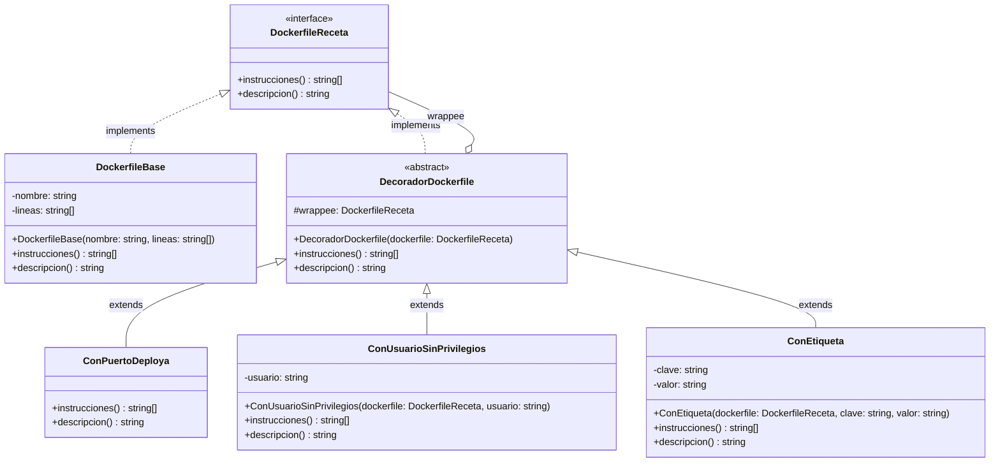
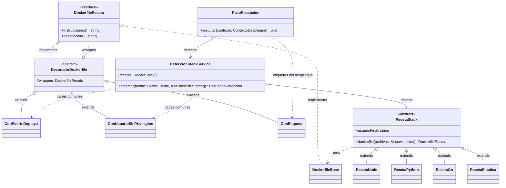

# Design

## Context

M4-03 está en `main` ([archivo del change](../archive/2026-10-18-feat-m4-deteccion-stack/design.md)). `DeteccionStackService` prueba las recetas en orden (Strategy + Chain of Responsibility) y devuelve `ResultadoDeteccion.dockerfile` como texto. Cada receta arma ese texto con una función de [plantillas.ts](../../../apps/api/src/modules/construccion/deteccion/plantillas.ts) y `PasoRecepcion` lo escribe como `Dockerfile.deploya`. Hoy las cuatro funciones terminan con las mismas líneas:

```ts
// plantillas.ts (antes): se repite en plantillaNode, plantillaPython, plantillaGo y plantillaEstatica
`USER ${UID_SIN_PRIVILEGIOS}`,      // con otro valor en cada una (salvo Node, que lo pone antes de npm ci)
`ENV PORT=${PUERTO_RECETAS}`,
`EXPOSE ${PUERTO_RECETAS}`,
```

`PasoRecepcion` es el único punto que conoce el commit, pero recibe un `string` ya cerrado: no puede agregar nada sin manipular texto. La motivación está en [proposal.md](proposal.md) (Why) y el comportamiento, en el [delta de la spec](specs/motor-construccion/spec.md).

## Goals / Non-Goals

**Goals:** que la base de cada receta tenga solo lo propio de su stack; poder agregar capas en dos momentos (detección y trabajador) sin tocar las bases; que la misma capa se pueda aplicar varias veces; que el texto final sea equivalente al de hoy, más las etiquetas.

**Non-Goals:** reordenar instrucciones dentro de la base (un decorador solo agrega al final), configurar capas por variable de entorno y decorar el `Dockerfile` del cliente.

## Decisions

### 1. El componente: `DockerfileReceta` con dos operaciones

```ts
/** Component: lo que responde tanto la base como cualquier pila de capas. */
export interface DockerfileReceta {
  instrucciones(): readonly string[];
  /** «Go 1.23 · puerto 8080 · usuario nonroot:nonroot»: va a la bitácora. */
  descripcion(): string;
}

/** Texto que se escribe como `Dockerfile.deploya`. */
export const textoDockerfile = (plan: DockerfileReceta): string => `${plan.instrucciones().join("\n")}\n`;
```

Son las mismas dos preguntas que `costo()` y `descripcion()` en la bebida del material: una operación acumula instrucciones y la otra acumula texto. Es una `interface` (no `abstract class`) porque no es un puerto inyectable de Nest, sino un tipo del dominio.

*Alternativas descartadas:* `texto(): string` (un decorador solo podría pegar texto y la bitácora no sabría qué capas hay) y un plan por zonas `construccion()/configuracion()/arranque()` (resuelve el orden, pero es más estructura de la que necesitan cuatro plantillas; ver Riesgos).

### 2. ConcreteComponent: `DockerfileBase`

```ts
export class DockerfileBase implements DockerfileReceta {
  constructor(private readonly nombre: string, private readonly lineas: readonly string[]) {}
  instrucciones(): readonly string[] { return this.lineas; }
  descripcion(): string { return this.nombre; }
}
```

Las funciones de `plantillas.ts` siguen siendo puras, pero devuelven `string[]` **sin** `ENV PORT`, `EXPOSE` ni el `USER` final. Cada receta devuelve `new DockerfileBase(this.nombre, plantillaGo())`. Una sola clase base alcanza: lo que cambia entre stacks son las líneas, no el comportamiento.

### 3. BaseDecorator: `DecoradorDockerfile` (agregación del `wrappee`)

```ts
/** Base Decorator: guarda cualquier `DockerfileReceta` (base u otra capa) y le delega. */
export abstract class DecoradorDockerfile implements DockerfileReceta {
  constructor(protected readonly wrappee: DockerfileReceta) {}
  instrucciones(): readonly string[] { return this.wrappee.instrucciones(); }
  descripcion(): string { return this.wrappee.descripcion(); }
}
```

El campo se llama `wrappee`, como en el material del curso (es el nombre del rol en el patrón, no un término del dominio). Es del tipo de la interfaz, no de `DockerfileBase`, y eso es lo que permite apilar capas. La relación es **agregación**: el `wrappee` existe antes y fuera del decorador (la receta crea la base y el servicio la envuelve después). La clase es `abstract` porque por sí sola no agrega nada: instanciarla sería una capa vacía.

### 4. ConcreteDecorators

| Decorador | `instrucciones()` agrega al final | `descripcion()` agrega |
|---|---|---|
| `ConPuertoDeploya` | `ENV PORT=8080`, `EXPOSE 8080` | ` · puerto 8080` |
| `ConUsuarioSinPrivilegios(usuario)` | `USER <usuario>` | ` · usuario <usuario>` |
| `ConEtiqueta(clave, valor)` | `LABEL clave="valor"` (con `"` y `\` escapados) | ` · etiqueta <último segmento de la clave>` |

```ts
export class ConPuertoDeploya extends DecoradorDockerfile {
  instrucciones(): readonly string[] {
    return [...super.instrucciones(), `ENV PORT=${PUERTO_RECETAS}`, `EXPOSE ${PUERTO_RECETAS}`];
  }
  descripcion(): string {
    return `${super.descripcion()} · puerto ${PUERTO_RECETAS}`;
  }
}
```

`ConEtiqueta` es el «doble caramelo»: una sola clase aplicada tres veces con claves distintas, en lugar de una clase por etiqueta.

### 5. El cliente arma la pila en dos momentos

**Detección (alta y trabajador)**: `capasComunes(base, usuarioFinal)` en `deteccion/capas/capas-comunes.ts`, que `DeteccionStackService` llama sobre la base de la receta ganadora:

```ts
export function capasComunes(base: DockerfileReceta, usuarioFinal: string | null): DockerfileReceta {
  let plan: DockerfileReceta = new ConPuertoDeploya(base);
  if (usuarioFinal) plan = new ConUsuarioSinPrivilegios(plan, usuarioFinal);
  return plan;
}
```

Cada receta declara `readonly usuarioFinal: string | null` (Node `null`, Python `"10001"`, Go `"nonroot:nonroot"`, estática `"101"`). Es un dato de la Strategy, no un `switch` por stack, y es el `if (slackActivo)` del material.

**Trabajador**: `PasoRecepcion` recibe el plan ya decorado y agrega las etiquetas del commit con `etiquetasDelDespliegue(plan, { sha, urlRepositorio, subdominio })` (`deteccion/capas/etiquetas-despliegue.ts`). Después escribe `textoDockerfile(plan)` y registra `Capas: ${plan.descripcion()}`.

```ts
let plan = deteccion.dockerfile;                         // ConUsuarioSinPrivilegios(ConPuertoDeploya(DockerfileBase))
plan = etiquetasDelDespliegue(plan, { sha, urlRepositorio, subdominio });
await this.clonador.escribir(directorio, DOCKERFILE_GENERADO, textoDockerfile(plan));
bitacora.escribir(this.etapa, `Capas: ${plan.descripcion()}`);
```

Las fábricas de capas son funciones cortas y aparte, para que el armado no se enrede (desventaja del material) y se pruebe solo.

*Alternativa descartada:* que cada receta envuelva su propia base, porque repetiría el armado en cuatro clases y las etiquetas igual tendrían que venir del trabajador.

### 6. Contrato: `ResultadoDeteccion.dockerfile: DockerfileReceta | null`

El trabajador necesita el objeto, no el texto, para seguir apilando. El único consumidor externo es M3, que no lee el campo ([despliegues.md](../../../docs/contratos/despliegues.md): «M3 lo ignora»). Va como **v3.4, solo cambia el tipo de un campo**. Este change actualiza el contrato y no toca código de M3; el aviso a Eduardo va en la descripción del PR.

### Diagrama de clases

**1. El patrón.** Archivo: `docs/diagramas/m1-m10/m4-clases-capas-dockerfile.mmd`. Tiene la misma forma que el diagrama de referencia del curso (Component, ConcreteComponent, BaseDecorator abstracto con `#wrappee` y ConcreteDecorators):



**2. La cadena en el cliente (Go en el trabajador).** El de más afuera lo arma `PasoRecepcion`; los dos de adentro, `DeteccionStackService`:

```mermaid
flowchart LR
    Cliente["paso-recepcion.ts"]
    E3["ConEtiqueta (proyecto)"]
    E2["ConEtiqueta (source)"]
    E1["ConEtiqueta (revision)"]
    U["ConUsuarioSinPrivilegios"]
    P["ConPuertoDeploya"]
    B["DockerfileBase (Go 1.23)"]

    Cliente --> E3
    E3 -->|"wrappee"| E2
    E2 -->|"wrappee"| E1
    E1 -->|"wrappee"| U
    U -->|"wrappee"| P
    P -->|"wrappee"| B
```



`instrucciones()` baja por los `wrappee` hasta la base y, de regreso, cada capa agrega sus líneas al final. `descripcion()` sale «Go 1.23 · puerto 8080 · usuario nonroot:nonroot · etiqueta revision · etiqueta source · etiqueta proyecto».

**3. Diagrama general (el patrón dentro de M4).** Las mismas clases van a `clases-unificado.mmd`:



| Relación | Notación | Dónde |
|---|---|---|
| Realización (`implements`) | `<\|..` | `DockerfileBase` y `DecoradorDockerfile` → `DockerfileReceta` |
| Herencia (`extends`) | `<\|--` | los tres decoradores concretos → `DecoradorDockerfile`; las recetas → `RecetaStack` |
| Agregación | `o--` | `DecoradorDockerfile` guarda **un** `DockerfileReceta` (`wrappee`) que existe sin él; `DeteccionStackService` guarda las recetas |
| Asociación | `-->` | `PasoRecepcion` usa `DeteccionStackService` |
| Dependencia (crea o instancia al armar) | `..>` | las recetas crean la base; los clientes instancian los decoradores |

## Diseño: SOLID y patrones

| Clase / función | Patrón | Principio | Por qué |
|---|---|---|---|
| `DockerfileReceta` | Decorator · Component | I, D | Dos operaciones; clientes y capas dependen de la interfaz, no de la base |
| `DockerfileBase` | Decorator · ConcreteComponent | S | Solo lo propio del stack |
| `DecoradorDockerfile` | Decorator · BaseDecorator | L | Cualquier capa sustituye a la base: el cliente no distingue |
| `ConPuertoDeploya`, `ConUsuarioSinPrivilegios`, `ConEtiqueta` | Decorator · ConcreteDecorator | S, O | Una capa, una clase; una capa nueva es una clase nueva, sin tocar las bases |
| `RecetaStack.dockerfile` + `usuarioFinal` | Strategy (ya existente) | O | La receta elige la base y declara su usuario; sin `switch` por stack |
| `capasComunes`, `etiquetasDelDespliegue` | Decorator · Client | S | El armado de la pila vive en un solo lugar por momento |
| `DeteccionStackService`, `PasoRecepcion` | Chain of Responsibility (ya existente) | S | Siguen orquestando; delegan el armado |

Decorator ≠ decoradores de TypeScript: `@Injectable()` o `@UsuarioActual()` son decoradores del lenguaje. Aquí es el patrón GoF, y los archivos van en `deteccion/capas/` sin el sufijo `.decorator.ts`.

Cambios de clases: nuevas `DockerfileReceta`, `DockerfileBase`, `DecoradorDockerfile`, `ConPuertoDeploya`, `ConUsuarioSinPrivilegios` y `ConEtiqueta`. En `RecetaStack`, `dockerfile()` devuelve `DockerfileReceta` y se agrega `usuarioFinal`. Todo va a `clases-unificado.mmd` en el mismo PR.

## Risks / Trade-offs

- **[Orden de las instrucciones]** Los decoradores agregan al final, así que `ENV`, `EXPOSE`, `USER` y `LABEL` quedan después del `CMD`. En Docker esas instrucciones configuran la imagen final sin importar su posición respecto de `CMD`, pero el archivo se lee distinto. → Se acepta. Una prueba verifica que en la imagen resultante la última instrucción `USER` sea la esperada y que `PORT` y `EXPOSE` estén una sola vez. Si algún día una capa necesita ir antes de un `RUN`, ese es el momento del plan por zonas.
- **[El orden de la pila cambia el resultado]** (desventaja del material): si `ConUsuarioSinPrivilegios` se aplica antes de una capa que hiciera `RUN`, ese `RUN` correría sin privilegios. → Ninguna capa hace `RUN`, y el orden vive solo en `capasComunes` y `etiquetasDelDespliegue`.
- **[La estática depende de una capa para no correr como root]** Su base termina en `USER root` (necesita borrar `.git`). Si alguien quita `usuarioFinal`, la imagen correría como root. → Escenario «El sitio estático no termina como root» y una prueba por receta de que la última instrucción `USER` no es `root`.
- **[Cambio de tipo en el contrato]** → M3 no lee `dockerfile`. Se avisa igual y se sube la versión.

## Migration Plan

Solo cambia código del trabajador y de la detección. No hay datos ni migraciones. Los despliegues en curso al desplegar la nueva versión terminan con el código viejo, porque cada trabajo detecta de nuevo. Para revertir, basta revertir el PR.
